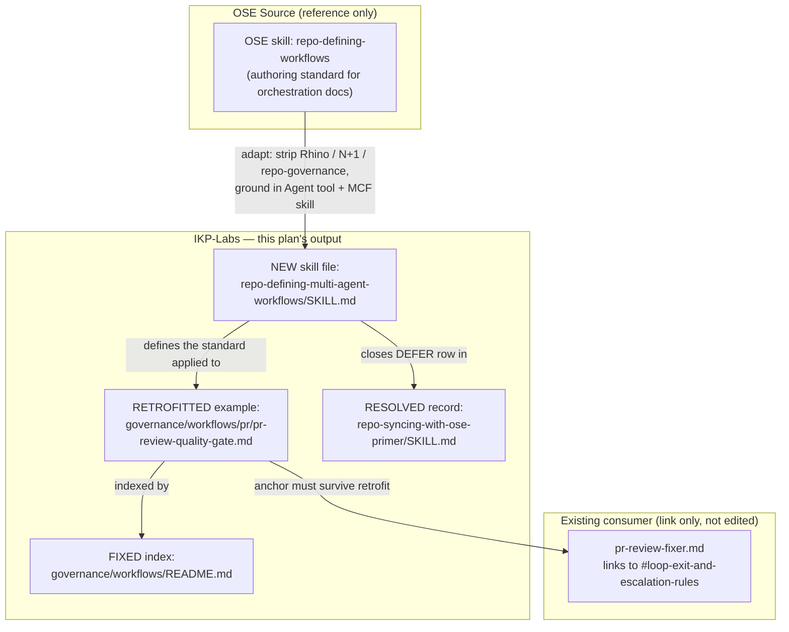

# Repo: Defining Multi-Agent Workflows — Technical Design

## Claim Labels Used in This Document

Per `plan-creating-project-plans`'s anti-hallucination rule, every non-trivial claim below is
tagged:

- **[Repo-grounded]** — verified by reading the actual file in this commit
- **[Judgment call]** — an explicit, labeled design decision, not a verified fact
- **[Unverified]** — flagged for confirmation before the implementing PR starts

---

## Architecture Overview

This plan produces one new document (the skill) and modifies three existing ones. There is no
runtime architecture — every artifact here is a markdown document read by a human or an agent,
never executed by a tool.



**Diagram description for non-visual readers**: the OSE source skill is adapted (stripping
OSE-specific runtime concepts) into a new IKP-Labs skill file. That new skill defines the
standard applied to the one real existing orchestration document in this repo, which is also
referenced by the `governance/workflows/README.md` index and linked to (by anchor) from
`pr-review-fixer.md`. Creating the new skill is also what allows the DEFER record in the sync
primer to be closed.

---

## Component 1 — The New Skill: `repo-defining-multi-agent-workflows`

### File

`.claude/skills/repo-defining-multi-agent-workflows/SKILL.md` **[Repo-grounded — confirmed this
path does not currently exist]**

### Header (matches sibling-skill convention, e.g. `repo-applying-maker-checker-fixer/SKILL.md`)

```markdown
# Skill: Defining Multi-Agent Workflows

**Category**: Repository Governance
**Purpose**: Standards for authoring reusable, validated multi-agent orchestration documents in
IKP-Labs — documents that describe how multiple Claude Code agents coordinate through
sequential, parallel, or conditional phases toward a shared, verifiable goal.
**Used By**: None yet — applied ad hoc (by `plan-maker`, or directly in conversation) when
authoring or retrofitting a workflow document. See "Adoption Note" below.
```

**[Judgment call]**: the "Used By: None yet" framing is unusual among this repo's skill files
(every other skill lists at least one agent). This is intentional and resolved via grilling
(Q3) — it is the honest answer given research found zero existing agents whose job is authoring
this kind of document. An "Adoption Note" subsection makes this explicit rather than leaving a
reader to wonder if it's an oversight:

```markdown
## Adoption Note

No agent currently declares this skill in `permission.skill:`. It is applied ad hoc today —
read directly during plan work (e.g., by `plan-maker`) or in conversation, whenever someone
authors or retrofits a `governance/workflows/` orchestration document. If a dedicated authoring
agent for this domain is ever justified, add this skill to its `permission.skill:` list and
update this note.
```

### Content Adaptation from OSE Source

The full OSE source text (verified via `gh api`, quoted in the originating task) maps to the new
skill as follows:

| OSE section                                                                                                                                     | IKP-Labs adaptation                                                                                                                                                                                                                                                                                                                                                                                                                                                                                                                                                                                                                                                                                                                      |
| ----------------------------------------------------------------------------------------------------------------------------------------------- | ---------------------------------------------------------------------------------------------------------------------------------------------------------------------------------------------------------------------------------------------------------------------------------------------------------------------------------------------------------------------------------------------------------------------------------------------------------------------------------------------------------------------------------------------------------------------------------------------------------------------------------------------------------------------------------------------------------------------------------------- |
| `## Purpose`                                                                                                                                    | Kept, reworded to reference IKP-Labs's actual consumer base (plan work, `governance/workflows/`) instead of OSE's own framing                                                                                                                                                                                                                                                                                                                                                                                                                                                                                                                                                                                                            |
| `## Workflow Structure` — "Two-key frontmatter (`description`, `when_to_use`)... YAML colon-quoting rule... contract never goes in frontmatter" | **Kept verbatim** — see Adaptation Decision 1 below (resolved via live grilling as "Fork 1," not the original written default). Workflow documents under `governance/workflows/` use the same two-key YAML frontmatter (`description`, `when_to_use`) OSE's standard specifies, even though no sibling doc in that directory currently uses frontmatter — the body still carries the seven-section contract (Goal and Termination, Inputs, Outputs, Steps, Termination Criteria, Example Usage, Related Workflows) as plain markdown H2 headings under the H1 title, frontmatter carries only the two metadata keys.                                                                                                                     |
| `## Execution Patterns` — Sequential/Parallel/Conditional/Mixed worked examples                                                                 | Kept conceptually, but the worked example is swapped: OSE's own hypothetical examples are replaced with `pr-review-quality-gate.md`'s actual Sequential, hard-gated loop (maker→fixer→CI-gate, repeated N times) as the Sequential pattern illustration. Parallel/Conditional/Mixed are described in the abstract (IKP-Labs has no existing example of these yet) and explicitly labeled as such — not presented as if a real example exists                                                                                                                                                                                                                                                                                             |
| `## Standard Input Parameters` — `max-concurrency` (N+1 model), `dry-run`, `verbose`                                                            | **Adapted, not carried over verbatim** — see Adaptation Decision 3 below. `max-concurrency`/N+1 is dropped entirely (no concurrent background-agent runtime exists here — `pr-review-quality-gate.md`'s own loop is explicitly "strictly sequential... never parallel"). Replaced with the one parameter pattern IKP-Labs's real example actually has: a **cycle/iteration count** with an explicit default and a documented hard ceiling (`N = 3`, "a hard ceiling, never extended past this count"). `dry-run` and `verbose` are kept as optional, not-yet-exercised parameters a workflow MAY document if relevant                                                                                                                    |
| `## Common Mistakes` (5 items)                                                                                                                  | Items 1–4 kept as-is, since frontmatter is now in active use (Fork 1 resolution, Adaptation Decision 1): unquoted colons in YAML, contract fields leaking into frontmatter instead of the body, missing agent dependencies, and no success criteria are all real risks for a document with a frontmatter block (items 3 and 4 are additionally directly evidenced by `pr-review-quality-gate.md`'s own "Depends on" fields and Done-Definition section). Only item 5 is **replaced** — OSE's "missing parameters documentation" framing is swapped for one grounded in the real example: omitting an explicit iteration ceiling, which `pr-review-quality-gate.md` treats as a correctness-critical omission (risk of an unbounded loop) |
| `## Workflow File Naming` — `[workflow-name].md`, plain-named, no numbered prefix                                                               | Kept verbatim — `pr-review-quality-gate.md` already follows this convention                                                                                                                                                                                                                                                                                                                                                                                                                                                                                                                                                                                                                                                              |
| `## Quality Checklist`                                                                                                                          | Adapted to drop the frontmatter-specific bullet and the OSE-specific phrasing; kept the substantive bullets (Goal/Termination clarity, Inputs/Outputs documented, execution phases and dependencies explicit, success criteria, example usage, related workflows linked)                                                                                                                                                                                                                                                                                                                                                                                                                                                                 |

### Adaptation Decisions (new forks that surfaced while writing this design)

These three decisions were **not** part of the original six grilled questions. Each is resolved
here with a recommended default, per `grill-me`'s rule that a new fork emerging during writing
must be grilled before the plan is considered done. They are flagged explicitly for the
post-write grill-me pass (see the plan's final report) rather than silently assumed.

**Adaptation Decision 1 — YAML frontmatter IS used on `governance/workflows/` documents**
**[Resolved via live grilling — "Fork 1" — overriding this document's original written default]**:
OSE's standard mandates a two-key YAML frontmatter block (`description`, `when_to_use`) on
every workflow document. IKP-Labs's `governance/workflows/` directory has zero precedent for
frontmatter on any of its five existing files (four canonical docs + `pr-review-quality-gate.md`)
— they all currently open directly with an H1. The first draft of this design defaulted to
dropping frontmatter for that reason. **That default was overridden**: the retrofit of
`pr-review-quality-gate.md` adopts OSE's two-key frontmatter **verbatim**. Rationale (from the
live grilling): frontmatter schema is a structural/mechanical convention, not product-specific
content — exactly the category where staying aligned with the senior reference repo (OSE)
avoids confusion for anyone discussing this doc who is also familiar with `ose-public`'s
structure. The blast radius is small: `pr-review-quality-gate.md` is the only real workflow
document that exists in this repo today (`governance/workflows/README.md` is a placeholder
index, not itself a workflow document, and is explicitly out of scope for this frontmatter
decision — it is fixed per Component 3 below with no frontmatter of its own). The body still
carries the full seven-section contract as plain markdown H2 headings; frontmatter carries only
the two metadata keys:

```markdown
---
description: '[one-line goal]'
when_to_use: '[one-line trigger — quote the whole value if it contains a colon]'
---

# [Workflow Name]

## Goal and Termination

...
```

The YAML colon-quoting rule applies here exactly as OSE's `## Common Mistakes` item 1 warns —
e.g. `description: "PR-Review Maker→Fixer Cycle: sequential review loop"` MUST be quoted,
since an unquoted value containing a colon breaks YAML parsing.

**Adaptation Decision 2 — Termination/success criteria may be rigorous prose, not mandatory
Gherkin** **[Judgment call, Recommended — flagged for confirmation]**: OSE's checklist says
"Success criteria in Gherkin format." IKP-Labs has a dedicated `plan-writing-gherkin-criteria`
skill and could mandate Given/When/Then here too. But `pr-review-quality-gate.md`'s own
Done-Definition section is enumerated, numbered prose with embedded caveats (e.g., "a thread may
be legitimately replied to and resolved while the corresponding fix sits uncommitted... verify
against the PR's head commit — not against the resolved-thread count") that would lose precision
if forced into single-line Given/When/Then scenarios. **Resolution used in this design**: the
new skill requires Termination Criteria to be either Gherkin Given/When/Then **or** an
equivalently rigorous, independently-verifiable enumerated checklist (each item naming an exact
command or observable state) — not free prose without verification hooks. This means PR2's
retrofit does **not** need to rewrite `pr-review-quality-gate.md`'s Done-Definition into Gherkin;
it needs to confirm the existing numbered list already meets the "independently verifiable"
bar (it does — every item names exact `git`/`gh` commands).

**Adaptation Decision 3 — No `max-concurrency` parameter** **[Judgment call, high confidence,
not flagged for re-grilling]**: covered in the mapping table above. Unlike Decisions 1 and 2,
this one has no real trade-off to weigh — IKP-Labs has no concurrent background-agent runtime,
so carrying over a parameter for one would be fabricating a capability. Dropping it is not a
style preference, it is a correctness requirement (ties to this plan's NFR-3).

---

## Component 2 — Retrofit: `governance/workflows/pr/pr-review-quality-gate.md`

### Current Structure **[Repo-grounded]**

```text
# PR-Review Maker→Fixer Cycle Workflow
## Purpose
## When to Use
## Execution Mode
## Participants
## Loop Algorithm                        (includes a mermaid sequence diagram)
## Steps                                  (0. Resolve Loop Inputs ... 4. Done-Definition Check)
## GitHub Reviews API Mechanics
## Done-Definition                        (+ "Hardened Merge Preconditions" subsection)
## Loop-Exit and Escalation Rules
## Applicability
## Related Workflows
## Notes
```

### Canonical Section Set (from the new skill, per Adaptation Decision 1 — Fork 1 resolution)

```text
---
description: "[one-line goal, colon-quoted]"
when_to_use: "[one-line trigger]"
---
# [Workflow Name]
## Goal and Termination
## Inputs
## Outputs
## Steps
## Termination Criteria
## Example Usage
## Related Workflows
```

### Section-Mapping Table (the retrofit's actual work, for PR2's checklist)

| New canonical section                           | Sourced from (old sections)                                                                                  | Change needed                                                                                                                                                                                                                                                                                                                                                                                                           |
| ----------------------------------------------- | ------------------------------------------------------------------------------------------------------------ | ----------------------------------------------------------------------------------------------------------------------------------------------------------------------------------------------------------------------------------------------------------------------------------------------------------------------------------------------------------------------------------------------------------------------- |
| Frontmatter (`description`, `when_to_use`) + H1 | `## Purpose` + `## When to Use`                                                                              | **New** — compress each into its one-line frontmatter value (colon-quoted per the YAML rule); keep the fuller prose from both as the opening paragraph(s) under `## Goal and Termination`                                                                                                                                                                                                                               |
| `## Goal and Termination`                       | `## Purpose` (goal half) + `## Execution Mode` (sequential/hard-gated framing)                               | Merge; state the goal and the high-level termination condition (N cycles done, done-definition satisfied) in one section, matching OSE's intent for this section to be a short orienting summary                                                                                                                                                                                                                        |
| `## Inputs`                                     | Scattered across `### 0. Resolve Loop Inputs` and each step's `**Args**` line                                | **New section** — consolidate: PR reference, cycle count (default 3, hard ceiling)                                                                                                                                                                                                                                                                                                                                      |
| `## Outputs`                                    | Scattered across each step's `**Output**` line                                                               | **New section** — consolidate: posted review comments, pushed fixes, CI-green confirmation, loop status (`done`/`escalated`)                                                                                                                                                                                                                                                                                            |
| `## Steps`                                      | `## Steps` (already exists, sections 0–4)                                                                    | Kept — already matches the canonical name and already documents Agent/Args/Output/Depends-on/Success-criteria/On-failure per step, which exceeds the standard's bar                                                                                                                                                                                                                                                     |
| `## Termination Criteria`                       | `## Done-Definition` + `## Loop-Exit and Escalation Rules`                                                   | Merge under the new heading name. Per Adaptation Decision 2, keep as enumerated, command-backed prose — do not force into Gherkin. **The `#loop-exit-and-escalation-rules` anchor `pr-review-fixer.md:185` depends on must be preserved or the cross-reference updated in the same PR**                                                                                                                                 |
| `## Example Usage`                              | Not previously a dedicated section — implicit in `## Loop Algorithm`'s pseudocode + mermaid sequence diagram | Promote `## Loop Algorithm`'s content into this section (keep the pseudocode and the mermaid sequence diagram verbatim)                                                                                                                                                                                                                                                                                                 |
| `## Related Workflows`                          | `## Related Workflows` (already exists)                                                                      | Kept as-is                                                                                                                                                                                                                                                                                                                                                                                                              |
| _(dropped as a standalone heading, folded in)_  | `## GitHub Reviews API Mechanics`, `## Applicability`, `## Notes`                                            | These don't map 1:1 onto the canonical set. **[Judgment call, Recommended]**: keep them as supplementary sections _after_ `## Related Workflows` rather than deleting real content — the canonical set is a minimum, not a maximum. Label this choice explicitly in the retrofitted doc's own structure (e.g., a short "Supplementary" note) so a future reader knows these are intentionally additional, not mis-filed |

### Required Anchor Preservation

**[Repo-grounded]**: `.claude/agents/pr-review-fixer.md:185` contains:

```markdown
[Loop-Exit and Escalation Rules](../../governance/workflows/pr/pr-review-quality-gate.md#loop-exit-and-escalation-rules)
```

Markdown anchors are generated from heading text. If the retrofit renames "Loop-Exit and
Escalation Rules" to anything else (e.g., folding it into "Termination Criteria" without
preserving a matching sub-heading), this link breaks. **PR2 must do one of**:

1. Keep a `### Loop-Exit and Escalation Rules` sub-heading nested under `## Termination
Criteria` (anchor `#loop-exit-and-escalation-rules` still resolves), or
2. Update `pr-review-fixer.md:185`'s link target to match whatever the new heading becomes, in
   the same PR.

Option 1 is **[Judgment call, Recommended]** — it requires editing only one file instead of two,
and a nested sub-heading under "Termination Criteria" is a faithful, non-lossy placement for
this content.

---

## Component 3 — Fix: `governance/workflows/README.md`

### Current Content **[Repo-grounded]**

```markdown
# Workflows

Reusable workflow specifications for recurring processes in IKP-Labs.

> Placeholder — workflow docs will be added here as the project scales (e.g., plan execution workflow, CI/CD workflow, release workflow).
```

### Target Content

```markdown
# Workflows

Reusable, multi-agent orchestration specifications for recurring processes in IKP-Labs. Every
document here follows the standard defined in
`.claude/skills/repo-defining-multi-agent-workflows/SKILL.md`.

## Current Workflows

| Workflow                    | Path                                                             | Summary                                                                                                             |
| --------------------------- | ---------------------------------------------------------------- | ------------------------------------------------------------------------------------------------------------------- |
| PR-Review Maker→Fixer Cycle | [`pr/pr-review-quality-gate.md`](./pr/pr-review-quality-gate.md) | Sequential, CI-gated N-cycle review loop between `pr-review-maker` and `pr-review-fixer`, run before every PR merge |

More workflow documents will be added here as new multi-agent orchestrations are defined.
```

---

## Component 4 — DEFER Resolution: `repo-syncing-with-ose-primer/SKILL.md`

### Removal

Delete this row from the "Deferred — Needs Product Decision" table **[Repo-grounded — current
line 167]**:

```markdown
| `repo-defining-workflows` (skill) | `.claude/skills/repo-defining-workflows/SKILL.md` | Topic mismatch, not a content gap — ... |
```

If this is the only remaining row, the table is left with just its header row (not deleted as a
section) — a future DEFER item may need it again; the section header itself documents the
process regardless of current row count.

### Harness Inventory Update

Current **[Repo-grounded — current lines 136–140]**:

```markdown
| Skills | 30 | 2026-10-06 (Round 5 — content verified; count corrected from stale 27 to actual 30) |
```

New:

```markdown
| Skills | 31 | 2026-10-16 (added `repo-defining-multi-agent-workflows`, resolving the Round 5 `repo-defining-workflows` DEFER item) |
```

The `Agents` and `Hooks` rows are unchanged (this plan creates zero agents and zero hooks).

### Footer

Bump `**Last Updated**: 2026-10-06` to `**Last Updated**: 2026-10-16`.

---

## Example Usage Section (what the new skill itself shows as a worked example)

The new skill's own `## Example Usage` section quotes `pr-review-quality-gate.md`'s retrofitted
"Example Usage" section (Component 2 above) as the end-to-end illustration — not a second,
invented example. This keeps the skill self-consistent: the standard, and its one proof of
applicability, point at the same real document.

---

## Risks Specific to This Design

- **Anchor breakage** — mitigated by the explicit preservation requirement in Component 2.
- **Retrofit scope creep into a content rewrite** — mitigated by Adaptation Decision 2
  (prose Termination Criteria stays prose) and by FR-2's acceptance criterion that the retrofit
  introduces zero information loss.
- **Frontmatter introduces a YAML-syntax failure mode that didn't exist before** (colon-quoting,
  malformed keys) — mitigated by the explicit colon-quoting rule restored in `## Common
Mistakes` and by running `npm run lint:md` (and a YAML-parse spot-check, since markdownlint
  does not itself validate frontmatter YAML syntax) on the retrofitted file before commit.
- **One adaptation decision (Gherkin-vs-prose for Termination Criteria) remains a judgment
  call, not yet grilled live** — flagged explicitly in this document and in the plan's final
  report for confirmation before PR2 begins. (The frontmatter decision — originally the other
  judgment call here — was resolved via live grilling as "Fork 1"; see Adaptation Decision 1
  above.)

---

## Related

- `.claude/skills/repo-applying-maker-checker-fixer/SKILL.md` — the pattern this skill
  cross-references for IKP-Labs's actual multi-role coordination convention
- `.claude/skills/plan-writing-gherkin-criteria/SKILL.md` — referenced in Adaptation Decision 2
- `.claude/skills/docs-creating-accessible-diagrams/SKILL.md` — followed for this document's
  mermaid diagram (no color-only distinctions; text labels on every node and edge)
