# Technical Design: Tooling: Nx Workspace Work

---

## Architecture Overview

This is a documentation-only change: one new skill file, two bookkeeping edits to existing catalog
documents. There is no runtime system to diagram in the usual sense. The diagram below instead
shows the **decision flow** the new skill documents — which situation routes to which section —
since that is the structure a reader needs to navigate the skill quickly.

```mermaid
%% Decision flow inside tooling-nx/SKILL.md
flowchart TD
    Start[Working an Nx workspace task] --> Q1{What is happening?}
    Q1 -->|Picking which projects to run| Graph[Select by the Project Graph&#44; Not by Hand]
    Q1 -->|Adding a new target| Target[Add a Target Only Where a Capability Exists]
    Q1 -->|A cached result looks wrong| Cache[Cache Only Deterministic Targets]
    Q1 -->|A boundary lint finding appeared| Boundary[Answer a Boundary Finding at the Dependency]

    Graph --> GraphAction[Run nx affected/nx run-many&#59; investigate missing or unexpected edges via the graph]
    Target --> TargetAction[Confirm the underlying command already works&#59; add the linter/tool first if it does not]
    Cache --> CacheAction[Rerun with --skip-nx-cache&#59; if the fresh run differs&#44; declare the missing input]
    Boundary --> BoundaryAction[Move the shared code or invert the dependency&#59; never retag just to pass the lint]

    GraphAction --> HandOff[Before Handing Off checklist]
    TargetAction --> HandOff
    CacheAction --> HandOff
    BoundaryAction --> HandOff
```



_Figure: Four entry situations in `tooling-nx/SKILL.md` — graph selection, target addition, cache
diagnosis, and boundary findings — each route to a specific section and converge on the same
"Before Handing Off" checklist._

**Text equivalent** (five nodes, more than the three-node accessibility threshold):

| Situation                        | Section                                     | Action                                                                                                      |
| -------------------------------- | ------------------------------------------- | ----------------------------------------------------------------------------------------------------------- |
| Picking which projects to run    | Select by the Project Graph, Not by Hand    | Run `nx affected`/`nx run-many`; treat an unexpected inclusion/omission as a graph finding, not a hand-edit |
| Adding a new target              | Add a Target Only Where a Capability Exists | Confirm the underlying command already works; add the missing tool first if it doesn't                      |
| A cached result looks wrong      | Cache Only Deterministic Targets            | Rerun with `--skip-nx-cache`; if the fresh run differs, find and declare the missing input                  |
| A boundary lint finding appeared | Answer a Boundary Finding at the Dependency | Move the shared code or invert the dependency; never retag just to pass the lint                            |
| All four                         | Before Handing Off                          | Shared closing checklist                                                                                    |

---

## Governance-Equivalent Mapping

OSE's `tooling-nx/SKILL.md` cross-references three governance documents IKP-Labs does not have as
standalone files:

| OSE reference                                                        | IKP-Labs replacement                                                            | Why                                                                                                                                                                                                                      |
| -------------------------------------------------------------------- | ------------------------------------------------------------------------------- | ------------------------------------------------------------------------------------------------------------------------------------------------------------------------------------------------------------------------ |
| `repo-governance/development/quality/stacks/nx-standards.md`         | `.claude/agents/ci-checker.md` → "Nx Conformance Checks (project.json)" section | Closest real equivalent for "what the rule is" at the target/tag-declaration layer. Verified: no `governance/` file defines Nx conventions beyond a few one-line command mentions in `governance/principles/general.md`. |
| `repo-governance/development/infra/nx-targets.md`                    | Same `ci-checker.md` section (its "Mandatory Nx Targets" table)                 | Same reasoning — this is the only place IKP-Labs records which targets a project role must carry.                                                                                                                        |
| `repo-governance/development/quality/testing/meaningful-coverage.md` | `.claude/skills/test-coverage-rules/SKILL.md`                                   | IKP-Labs's coverage-threshold rules (≥70% FE / ≥80% BE) live here, not in a separate "meaningful coverage" doc.                                                                                                          |

No new governance file is created to fill these gaps — the skill links to the real, existing
documents above instead of re-deriving or inventing new standards (per `requirements.md`
Non-Scope item 8).

---

## Skill Frontmatter Convention Check

OSE's `tooling-nx/SKILL.md` uses YAML frontmatter (`name`, `description`, `when_to_use`,
`compatibility`). Checked three real IKP-Labs skill files for the actual local convention:

- `.claude/skills/ci-standards/SKILL.md` — no YAML frontmatter; starts directly with
  `# Skill: CI Standards` followed by `**Category**:` / `**Purpose**:` / `**Used By**:` lines.
- `.claude/skills/repo-defining-multi-agent-workflows/SKILL.md` — same convention, `**Used By**:
None yet — applied ad hoc...`.
- `.claude/skills/docs-applying-diataxis-framework/SKILL.md` — same convention.

**Decision**: drop OSE's YAML frontmatter entirely; use the plain markdown header convention,
matching every other skill in this repository.

---

## Full Drafted Skill Content

The following is the complete intended content of `.claude/skills/tooling-nx/SKILL.md`. PR1
(see `checklist.md`) creates this file verbatim (adjusted only if a decision resolved during
post-write grilling requires a change).

````markdown
# Skill: Nx Tooling

**Category**: Infrastructure
**Purpose**: Guides day-to-day Nx workspace work — selecting projects by the graph, adding a
target only where a capability exists, tracing a stale cached pass to its missing input, and
answering a module-boundary finding
**Used By**: None yet — documentation-only, applied ad hoc whenever a developer or agent is
working the Nx graph (see "Adoption Note" below)

---

## Overview

This skill adds only the **procedure and judgement** of working through the Nx task runner — it
does not restate rules that already live elsewhere. The rule for which targets a project role must
carry, and how its tags should look, is owned by
[`ci-checker.md`'s "Nx Conformance Checks (project.json)" section](../../agents/ci-checker.md).
Coverage-threshold rules are owned by
[`test-coverage-rules/SKILL.md`](../test-coverage-rules/SKILL.md). The code inside each project
follows that project's own language skill (`swe-programming-typescript`, `swe-programming-java`,
`swe-programming-golang`). Where a sentence here seems to state a rule those documents already
own, the referenced document decides — this skill only tells you what to _do_ when you hit one of
four situations: picking projects, adding a target, diagnosing a cache, or resolving a boundary
finding.

**Adoption Note**: no agent currently declares this skill in `permission.skill:` — confirmed by
scanning OSE's own 77 canonical `agents/*.md` files, where zero agents (including `ci-checker`,
which does the closest adjacent static-config audit) reference `tooling-nx` either. Pull this
skill in ad hoc via the `Skill` tool whenever one of the four situations below applies.

---

## Start From What the Project Records

Before changing a project's targets or tags, read what IKP-Labs already records about it:

- The **four-dimension tag vocabulary** (`type:`/`platform:`/`lang:`/`domain:`) and which project
  roles require which targets — both defined in
  [`ci-checker.md`'s Nx Conformance Checks section](../../agents/ci-checker.md#nx-conformance-checks-projectjson).
- The project's own `project.json` for its declared targets, and `nx.json` for `targetDefaults`
  and `namedInputs` that apply to it even when not repeated locally. For example,
  `apps/kameravue-fe/project.json`'s `build` target doesn't declare `dependsOn` itself — that
  comes from `nx.json`'s `targetDefaults.build.dependsOn: ["^build"]`.

Then ask Nx what it actually resolved rather than trusting the file alone — run
`nx show project <name>` (e.g. `nx show project kameravue-fe`). Workspace-level defaults from
`nx.json` never appear by reading `project.json` in isolation, so a target's real `outputs` or
`dependsOn` can differ from what the project's own file shows.

---

## Select by the Project Graph, Not by Hand

Run change-scoped work through `nx affected` (or `nx run-many` for a full pass) with the targets
it needs, rather than typing out a project list by hand.

**This matters concretely in IKP-Labs today**: `.github/workflows/kameravue-ci.yml` and
`kameravue-scheduled-e2e.yml` currently hand-list each job per app (`frontend-lint`,
`frontend-tests`, `backend-tests`, …) rather than running `nx affected` — confirmed via
`grep -n "nx affected" .github/workflows/*.yml` returning no matches. That hand-listing is exactly
the anti-pattern this section warns about: it makes the current run pass, but silently misses a
project the _next_ change actually touches. (Changing CI itself to use `nx affected` is a separate,
larger decision outside this skill's scope — this section is about how to work locally and in
agent-driven changes today, not about rewriting the pipeline.)

When a project you expected is missing from an `nx affected` selection, that absence is the
finding: look for the dependency or input Nx cannot see. In this workspace, cross-project edges are
often declared via `implicitDependencies` — for example, `apps/kameravue-fe-e2e/project.json`
declares `"implicitDependencies": ["kameravue-fe", "kameravue-be"]`, and `apps/taskly-be-e2e/project.json`
declares `"implicitDependencies": ["taskly-be"]`. If an e2e project you expected to see affected by
a backend change is missing, check whether that edge is actually declared — don't just add the
project to the run by hand, which makes this run pass and leaves the graph still blind on the next
one. When a project appears that you didn't expect, read the graph (`nx graph` or
`mcp__plugin_nx_nx-mcp__nx_workspace`) before assuming Nx is wrong — an unexpected edge is often a
real import.

---

## Add a Target Only Where a Capability Exists

Before adding a target, confirm the project can really do what the name claims. This repository
already has two real, currently-flagged examples of what happens when that check is skipped —
both documented in `ci-checker.md`'s findings and `ci-fixer.md`'s fix categories:

- **`kameravue-be` has no `lint` target.** Its `pom.xml` has no Checkstyle, PMD, or Spotless plugin
  configured — there is no working lint command to point a target at. `ci-fixer.md` correctly
  marks this `UNCERTAIN` rather than auto-adding a target, and recommends adding the linter plugin
  first, as its own separate change.
- **`taskly-be` has no `test` target.** Unlike the `lint` case, `go test ./...` already works
  against `taskly-be`'s real `go.mod`-backed test files — so `ci-fixer.md` marks this
  **safe to auto-fix**, adding:

  ```json
  "test": {
    "executor": "nx:run-commands",
    "options": { "command": "go test ./...", "cwd": "apps/taskly-be" }
  }
  ```

The distinguishing question is always the same: does a working command for this capability already
exist? If yes, wiring an `nx:run-commands` target to it is safe. If no, the missing capability
(the linter plugin, the test file, the coverage tool) is a prerequisite change, not something to
paper over with a target that points at nothing. An inferred or hand-added target the project
cannot actually run is removed, never left in place to pass on nothing. Record each intentional
omission with its reason — `ci-checker.md`'s own findings table is where IKP-Labs currently does
this for `apps/*/project.json` gaps.

---

## Cache Only Deterministic Targets

When a cached result is suspect, rerun the target with `--skip-nx-cache`
(e.g. `nx test kameravue-be --skip-nx-cache`). If the fresh run fails where the cached one passed,
the cache replayed a result its inputs did not determine.

Ground this in IKP-Labs's real `nx.json`:

```json
"tasksRunnerOptions": {
  "default": {
    "options": { "cacheableOperations": ["build", "test", "lint", "e2e"] }
  }
},
"targetDefaults": {
  "dev":   { "cache": false, "continuous": true },
  "serve": { "cache": false, "continuous": true },
  "test":  { "outputs": ["{projectRoot}/coverage", "{projectRoot}/target/surefire-reports"] }
}
```

`dev` and `serve` are correctly never cached (`cache: false`) because they're long-running
dev-server processes, not deterministic build/test passes — this is the one case where "turn
caching off" is the standard, not a shortcut hiding a defect. For an actually cacheable target
(`build`, `test`, `lint`, `e2e`), if a fresh `--skip-nx-cache` run disagrees with the cached one,
find the missing input — usually a file another project owns, an environment variable, or a tool
version — and add it to the target's `inputs` or to one of `nx.json`'s `namedInputs`
(`default`, `sharedGlobals`, `production`), then confirm the cache now misses on that change.
Turning caching off for the target entirely hides the defect rather than fixing it, unless the
target is one IKP-Labs's standard already never caches (`dev`, `serve`).

---

## Answer a Boundary Finding at the Dependency

A module-boundary finding means one project reached another its tags forbid.

**Honest state of this in IKP-Labs today**: the four-dimension tag scheme
(`type:`/`platform:`/`lang:`/`domain:`) exists and is audited _statically_ by
`ci-checker.md`'s "Four-Dimension Tag Scheme" check — but no `@nx/enforce-module-boundaries`
ESLint rule is currently wired into this workspace to enforce it _live_. Confirmed: no
`@nx/eslint-plugin` dependency in the root `package.json`, no root ESLint config referencing it,
and `apps/kameravue-fe/eslint.config.mjs` only extends `next/core-web-vitals`/`next/typescript`.
`ci-checker.md` already has real findings against this tag scheme today — for example,
`kameravue-fe-e2e/project.json` currently uses `"scope:kameravue"` instead of the standard
`"domain:kameravue"`, and is missing a `lang:` tag entirely — but those are flagged by a periodic
static audit, not a live lint failure at build/lint time.

This section documents the procedure for _if/when_ a live boundary lint is ever added: a finding
means move the shared code to a project both sides may depend on, or invert the dependency.
Retagging a project or widening a constraint just to make the lint pass changes the architecture,
and that needs the tag-scheme owner's agreement — currently recorded via `ci-checker.md`'s findings
and `ci-fixer.md`'s corresponding tag-fix category, not a separate adapter document. Never treat a
tag-widening edit as a mechanical fix on the same footing as correcting a typo'd tag.

---

## Before Handing Off

- Every new project carries tags from the recorded four-dimension vocabulary
  (`type:`/`platform:`/`lang:`/`domain:`) — see `ci-checker.md`'s Four-Dimension Tag Scheme check.
- Every new target names a real capability; every intentional omission is recorded in
  `ci-checker.md`'s findings (or, once fixed, removed from them).
- Each new or changed cacheable target (`build`, `test`, `lint`, `e2e`) lists inputs sufficient
  that a `--skip-nx-cache` run agrees with the cached one.
- Change-scoped work was selected through `nx affected`/`nx run-many`, not a hand-picked project
  list — and any unexpected inclusion or omission was investigated against the graph, not silently
  overridden.
- Coverage-threshold gating, where applicable, matches
  [`test-coverage-rules/SKILL.md`](../test-coverage-rules/SKILL.md) (≥70% FE / ≥80% BE).

---

## Related Skills

- **`ci-standards`** — GitHub Actions and Nx `project.json` conformance standards this skill's
  "what the rule is" layer defers to
- **`test-coverage-rules`** — coverage-threshold rules this skill's hand-off checklist defers to
- **`repo-understanding-repository-architecture`** — the repository's Nx monorepo layout overview

---

**Last Updated**: October 2026
````

---

## Catalog Bookkeeping Edits (PR2)

### `docs/reference/claude-agents.md`

Current state (verified via `Read`): line 361 reads `The 30 skill directories under`; the table at
lines 367–398 has 30 rows and does not include `repo-defining-multi-agent-workflows`.

Edits:

1. Line 361: `The 30 skill directories under` → `The 32 skill directories under`.
2. Insert a new row, alphabetically positioned after `repo-assessing-criticality-confidence` and
   before `repo-defining-workflows` — "`repo-defining-multi-agent-workflows`" sorts before
   "`repo-defining-workflows`" because `m` < `w` at the first differing character (matches the
   table's existing alphabetical ordering; double-checked character-by-character after an initial
   draft of this plan mis-ordered it as coming _after_ `repo-defining-workflows`):

   ```markdown
   | [`repo-defining-multi-agent-workflows`](../../.claude/skills/repo-defining-multi-agent-workflows/SKILL.md) | Standards for authoring reusable multi-agent orchestration documents | not declared by any agent's `permission.skill:` |
   ```

3. Insert a new row, alphabetically positioned after `test-playwright-patterns` and before
   `wow-criticality-assessment`:

   ```markdown
   | [`tooling-nx`](../../.claude/skills/tooling-nx/SKILL.md) | Guides day-to-day Nx workspace work (project graph selection, target capability checks, cache diagnosis, boundary findings) | not declared by any agent's `permission.skill:`; its own `SKILL.md` links `ci-checker` and `ci-fixer` as the closest adjacent static-audit agents, though neither declares it |
   ```

Both new rows follow the exact style of the existing `docs-creating-accessible-diagrams` row (the
precedent pattern for a zero-agents-declared skill).

### `.claude/skills/repo-syncing-with-ose-primer/SKILL.md`

Current state (verified via `Read`): the "Harness Inventory Reference" table's Skills row reads:

```markdown
| Skills | 31 | 2026-10-16 (added `repo-defining-multi-agent-workflows`, resolving the Round 5 workflow-authoring DEFER item) |
```

Edit — update to:

```markdown
| Skills | 32 | 2026-10-28 (added `tooling-nx`, guidance for day-to-day Nx workspace work — no name collision, no DEFER record) |
```

Also update the `**Last Updated**:` footer line at the bottom of the file from `2026-10-16` to
`2026-10-28`.

---

## Implementation Approach

1. **PR1** — create `.claude/skills/tooling-nx/SKILL.md` with the content drafted above, verbatim
   unless post-write grilling changes a decision. Run `npm run lint:md` before committing.
2. **PR2** — apply the three catalog bookkeeping edits above in `docs/reference/claude-agents.md`
   and `repo-syncing-with-ose-primer/SKILL.md`; move this plan directory from
   `plans/in-progress/2026-10-28__tooling-nx/` to `plans/done/2026-10-28__tooling-nx/` via `git mv`;
   update this `README.md`'s status to "✅ Completed" with a completion date before the move.

## Technology Choices

None — this is a markdown-only change. No new dependencies, no code, no CI changes.

## Database Changes

None.

## API Design

None.

## Integration Points

- `.claude/skills/tooling-nx/SKILL.md` links to `.claude/agents/ci-checker.md` (anchor into its Nx
  Conformance Checks section) and `.claude/skills/test-coverage-rules/SKILL.md`. Neither of those
  two files is modified — the links are one-directional, read-only references.
- `docs/reference/claude-agents.md` and `repo-syncing-with-ose-primer/SKILL.md` are catalog/index
  documents; editing them does not change any agent or skill's actual behavior.
