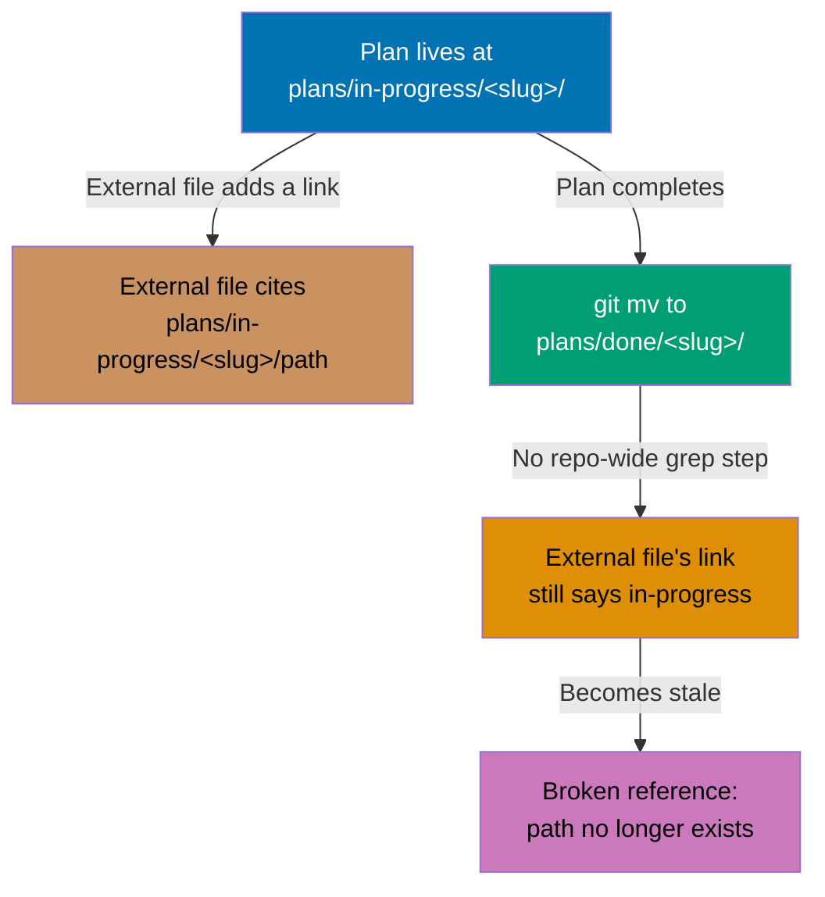

# Fix Stale Plan Path References - Technical Design

## Root Cause

Both stale references share the same mechanism: a plan is archived via
`git mv plans/in-progress/<slug>/ plans/done/<slug>/` (the standard archival
step documented in `plans/README.md` and the `plan-creating-project-plans`
skill), but a file _outside_ the archived plan's own folder had already
linked into the plan's pre-archival `plans/in-progress/<slug>/` path. The
archival `git mv` only moves the plan's own folder — it does not, and
cannot, rewrite paths in unrelated files that happen to reference the old
location. No automated step in this repo's plan-archival process greps the
rest of the repo for such references, so they go stale silently.

_Figure 1: An external file's link into a plan's `in-progress` path survives_
_the plan's own archival `git mv` unchanged, because the archival step moves_
_only the plan's own folder and never greps the rest of the repo for_
_inbound references. The link is now stale, pointing at a path that no_
_longer exists._

**Text equivalent:**

| Step | What happens                                                                 | Result                                           |
| ---- | ---------------------------------------------------------------------------- | ------------------------------------------------ |
| 1    | Plan lives at `plans/in-progress/<slug>/`                                    | Normal active-plan state                         |
| 2    | An external file (unrelated to the plan) adds a link citing that path        | Link is valid at the time it's written           |
| 3    | Plan completes; `git mv plans/in-progress/<slug>/ plans/done/<slug>/` runs   | Plan's own folder is correctly relocated         |
| 4    | No step in the archival process greps the rest of the repo for inbound links | External file's link is left untouched           |
| 5    | External file's link still reads `plans/in-progress/<slug>/`                 | Link is now stale — target path no longer exists |

This plan does not change the archival process (explicitly out of scope,
see `requirements.md` Resolved Decision #3) — it only repairs the two
already-stale links this mechanism produced.

## Affected Files and Exact Changes

### File 1: `docs/reference/claude-agents.md`

5 occurrences, all identical in content, each inside a "Known
frontmatter/filename mismatch" explanatory note. `[Repo-grounded]` — verified
via `grep -n` against the current file on 2026-10-29.

| Line | Context                                  | Before                                                                              | After                                                                        |
| ---- | ---------------------------------------- | ----------------------------------------------------------------------------------- | ---------------------------------------------------------------------------- |
| 62   | Top-of-file summary note, after "see"    | `` `plans/in-progress/2026-10-08__fix-claude-agents-catalog-doc/requirements.md` `` | `` `plans/done/2026-10-08__fix-claude-agents-catalog-doc/requirements.md` `` |
| 86   | ⚠ `docs-maker.md` callout, after "see"   | same as above                                                                       | same replacement                                                             |
| 94   | ⚠ `docs-checker.md` callout, after "see" | same as above                                                                       | same replacement                                                             |
| 129  | ⚠ `specs-maker.md` callout, after "see"  | same as above                                                                       | same replacement                                                             |
| 137  | ⚠ `test-checker.md` callout, after "see" | same as above                                                                       | same replacement                                                             |

Each occurrence is immediately followed on the next line by `Non-Scope #1.`
— that trailing text is unchanged; only the path segment
`plans/in-progress/` becomes `plans/done/` within each occurrence. No other
character on any of these 5 lines changes.

### File 2: `governance/workflows/pr/pr-review-quality-gate.md`

1 occurrence, inside a "Notes" bullet about the `pr-review-maker` /
`pr-review-fixer` cycle having already run live. `[Repo-grounded]` — verified
via `grep -n` against the current file on 2026-10-29.

| Line | Context                                            | Before                                                                       | After                                                                 |
| ---- | -------------------------------------------------- | ---------------------------------------------------------------------------- | --------------------------------------------------------------------- |
| 281  | "Agents implemented" note, worked-example citation | `` `plans/in-progress/2026-10-16__repo-defining-multi-agent-workflows/`'s `` | `` `plans/done/2026-10-16__repo-defining-multi-agent-workflows/`'s `` |

The trailing `'s own PR1 for a worked execution).` text on the same/next
line is unchanged; only the path segment `plans/in-progress/` becomes
`plans/done/`.

## Implementation Approach

Both fixes are literal string replacements of
`plans/in-progress/<archived-slug>` → `plans/done/<archived-slug>` at the
specific line(s) identified above. No other tooling, script, or generator
is involved — this is a direct edit to each Markdown file.

**Verification method** (identical for both files, run after editing each):

1. `grep -n "plans/in-progress/<archived-slug>" <file>` — must return zero
   matches.
2. `grep -n "plans/done/<archived-slug>" <file>` — must return the expected
   count (5 for `claude-agents.md`, 1 for `pr-review-quality-gate.md`).
3. `test -f plans/done/2026-10-08__fix-claude-agents-catalog-doc/requirements.md`
   (File 1) or `test -d plans/done/2026-10-16__repo-defining-multi-agent-workflows`
   (File 2) — must succeed, confirming the new path target actually exists.

## Code Structure

No code files are created or modified. Only these 2 existing Markdown
files change:

- `docs/reference/claude-agents.md` (5-line edit)
- `governance/workflows/pr/pr-review-quality-gate.md` (1-line edit)

## Technology Choices

None — this is a Markdown text correction. No framework, library, or
tooling decision applies.

## Database Changes

None.

## API Design

None.

## Integration Points

- `docs/reference/claude-agents.md` cross-references
  `plans/done/2026-10-08__fix-claude-agents-catalog-doc/requirements.md`,
  which already exists and is unmodified by this plan — this plan only
  corrects the _pointer_, not the target.
- `governance/workflows/pr/pr-review-quality-gate.md` cross-references
  `plans/done/2026-10-16__repo-defining-multi-agent-workflows/`, which
  already exists and is unmodified by this plan.
- Neither target plan folder is read, written, or otherwise touched by this
  plan's implementation — both are archived and closed.
