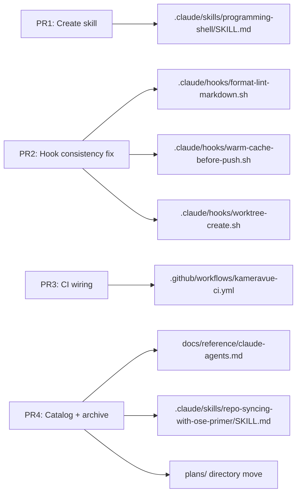

# Technical Design: Programming Shell Skill

---

## Architecture Overview

This plan has two kinds of changes: a documentation-only skill addition (PR1, PR4) and two
behavior-touching infrastructure fixes (PR2, PR3) scoped to their own risk boundaries. The diagram
below shows the decision flow the new skill documents, and separately, how the 4 PRs relate to the
real files they touch.

```mermaid
%% Decision flow inside programming-shell/SKILL.md
flowchart TD
    Start[Writing, changing, or reviewing a shell script] --> Q1{What is happening?}
    Q1 -->|First touching the file| First[Start From the First Line]
    Q1 -->|Adding new behavior| Belongs[Decide Whether It Belongs in Shell]
    Q1 -->|A substitution or conditional command appears| Trace[Trace Where Exit-on-Error Does Not Reach]
    Q1 -->|Writing an expansion or argument| Quote[Quote&#44; Then Check]
    Q1 -->|The change is ready| Test[Test the Script as Its Callers Run It]

    First --> HandOff[Before Handing Off checklist]
    Belongs --> HandOff
    Trace --> HandOff
    Quote --> HandOff
    Test --> HandOff
```



_Figure: Five entry situations in `programming-shell/SKILL.md` — reading the first line, deciding
scope, tracing exit-on-error, quoting/checking, and testing — each route to a specific section and
converge on the same "Before Handing Off" checklist._

**Text equivalent** (six nodes, more than the three-node accessibility threshold):

| Situation                             | Section                                  | Action                                                                                      |
| ------------------------------------- | ---------------------------------------- | ------------------------------------------------------------------------------------------- |
| First touching the file               | Start From the First Line                | Read the interpreter line and strict-mode setting before anything else                      |
| Adding new behavior                   | Decide Whether It Belongs in Shell       | Single-concern `jq` extraction + fixed-case branching stays shell; more than that moves out |
| A substitution or conditional appears | Trace Where Exit-on-Error Does Not Reach | Check explicitly wherever `set -e` doesn't see the failure                                  |
| Writing an expansion or argument      | Quote, Then Check                        | Quote every expansion; check every argument before first use                                |
| The change is ready                   | Test the Script as Its Callers Run It    | Invoke the script with the exact input shape its real caller sends                          |
| All five                              | Before Handing Off                       | Shared closing checklist                                                                    |



_Figure: Each PR's file-touch-set is disjoint from the others — PR2 never touches a file PR3
touches, and vice versa, which is the risk-boundary principle the PR Breakdown is built on._

**Text equivalent**:

| PR  | Files touched                                                                                                          |
| --- | ---------------------------------------------------------------------------------------------------------------------- |
| PR1 | `.claude/skills/programming-shell/SKILL.md` (new)                                                                      |
| PR2 | `.claude/hooks/format-lint-markdown.sh`, `.claude/hooks/warm-cache-before-push.sh`, `.claude/hooks/worktree-create.sh` |
| PR3 | `.github/workflows/kameravue-ci.yml`                                                                                   |
| PR4 | `docs/reference/claude-agents.md`, `.claude/skills/repo-syncing-with-ose-primer/SKILL.md`, this plan's directory       |

---

## Governance-Equivalent Mapping

OSE's `programming-shell/SKILL.md` cross-references 5 governance documents IKP-Labs does not have:

| OSE reference                                                     | IKP-Labs replacement                                | Why                                                                                                                                                                   |
| ----------------------------------------------------------------- | --------------------------------------------------- | --------------------------------------------------------------------------------------------------------------------------------------------------------------------- |
| `repo-governance/development/quality/code/shell-scripts.md`       | None — honest gap statement in the skill's Overview | Confirmed via `find governance -maxdepth 3 -type d`: no file under `governance/` covers shell-script mechanics.                                                       |
| `repo-governance/development/quality/stacks/shell-standards.md`   | None — honest gap statement                         | Same confirmation; no shell-specific standards file exists.                                                                                                           |
| `repo-governance/development/workflow/test-driven-development.md` | None — honest gap statement                         | `governance/development/workflow/implementation.md` mentions `bash` only inside example code fences, never as a TDD standards topic.                                  |
| `repo-governance/development/behaviour-driven-development.md`     | None — honest gap statement                         | No equivalent file; `governance/conventions/development.md` has no BDD section.                                                                                       |
| `../developing-applications/SKILL.md`                             | None — honest gap statement                         | IKP-Labs has `swe-developing-applications-common/SKILL.md`, but it is scoped to TypeScript/Java application code, not shell; linking it would overstate its coverage. |

Per Key Decision #6, no new governance file is created to fill these gaps. The skill states
plainly, in its own Overview section, that none of these exist in this repository today — matching
the honest-gap pattern `tooling-nx` used for its own broken cross-references.

---

## Skill Frontmatter Convention Check

OSE's `programming-shell/SKILL.md` uses YAML frontmatter (`name`, `description`, `when_to_use`,
`compatibility`). Per Key Decision #3, this is dropped in favor of the plain markdown header
convention confirmed across every real skill in this repository (`ci-standards/SKILL.md`,
`tooling-nx/SKILL.md`, `repo-defining-multi-agent-workflows/SKILL.md`) — `# Skill: <Name>` followed
by `**Category**:` / `**Purpose**:` / `**Used By**:` lines, no frontmatter block.

---

## Full Drafted Skill Content

The following is the complete intended content of `.claude/skills/programming-shell/SKILL.md`. PR1
(see `checklist.md`) creates this file verbatim. Note: this content describes the **post-PR2**
state of `.claude/hooks/*.sh` (all 5 hooks sharing one interpreter line and strict-mode setting) —
since PR2 lands immediately after PR1 within this same plan, the skill is written for its lasting,
correct state rather than the transient pre-PR2 inconsistency. If PR1 is reviewed before PR2 merges,
this is a known, deliberate, short-lived forward reference (see `checklist.md`'s PR1 notes).

```markdown
# Skill: Shell Programming

**Category**: Software Engineering
**Purpose**: Guides shell script work in this repository — checking the declared interpreter and
strict-mode setting first, deciding whether a change belongs in shell at all, tracing where
exit-on-error does not reach, quoting and checking arguments, and testing a script the way its
actual callers invoke it.
**Used By**: None yet — documentation-only, applied ad hoc whenever a developer or agent is
writing, changing, or reviewing a script under `.claude/hooks/*.sh` or any other shell script in
this repository (see "Adoption Note" below).

---

## Overview

This skill adds only the **procedure and judgment** of shell work — it does not invent rules this
repository has never stated. IKP-Labs has no standalone shell-standards or shell-mechanics
governance document today (confirmed: nothing under `governance/` is comparable to a
`shell-standards.md` or `shell-scripts.md`), and no dedicated test-driven-development governance
document either (`governance/development/workflow/implementation.md` and
`governance/conventions/development.md` mention `bash` only inside example code fences, not as a
standards topic). Where a sentence in this skill would otherwise defer to one of those documents,
it states the judgment directly instead, grounded in this repository's real `.claude/hooks/*.sh`
files — the only shell scripts currently version-controlled here.

**Adoption Note**: no agent currently declares this skill in `permission.skill:` — confirmed via
`grep -rn "permission.skill" .claude/agents/*.md`, which returns no shell-related reference. Pull
this skill in ad hoc via the `Skill` tool whenever a `.claude/hooks/*.sh` file (or any future shell
script) is written, changed, or reviewed.

---

## Start From the First Line

Read the interpreter line and the strict-mode setting before anything else; they decide which
dialect's rules apply and which failures the shell will actually catch for you. Every one of this
repository's 5 hooks under `.claude/hooks/` shares `#!/usr/bin/env bash` and `set -euo pipefail`
today, with one deliberate exception: a hook whose design requires it to never block its caller
keeps an explicit `|| true` on each risky line instead of relying on strict mode to stop it, and
that exception is commented in place, not left looking like an oversight.

No `shellcheck` or `shfmt` (or equivalent analyser/formatter) is installed or referenced anywhere
in this repository — confirmed via `which shellcheck shfmt` and a grep across `package.json` and
`.github/workflows/*.yml`. Until one is adopted, `bash -n <script>` (syntax check only, no style or
correctness analysis) is the closest available substitute — run it, and carry the review a real
analyser would otherwise do.

---

## Decide Whether It Belongs in Shell

Before adding behavior to a hook, ask what the addition actually is. Reading a tool-call's JSON
payload through a single `jq` filter, branching on a fixed, small set of known shapes, and exiting
with a decision is shell's job — every one of this repository's 5 hooks does exactly this today
(for example, `block-env-file-access.sh` extracts `tool_name`, `tool_input.file_path`, and
`tool_input.command` with one `jq -r` call each, then branches with `case`/`grep -qE` over a
handful of known patterns).

This repository has no documented size threshold for when a script should move to a language with
a unit-test layer — there is no `shell-standards.md` equivalent here, so the call is a judgment
one: if a future change needs more than one or two single-concern `jq` queries, adds retry/backoff
logic, or starts computing something rather than matching it, treat that as the signal to move the
logic into a small Node script (this is an npm/Node-based repository) invoked by the hook, rather
than deep-nesting the logic in shell. Raise this before writing the logic, not after.

---

## Trace Where Exit-on-Error Does Not Reach

Strict mode only stops the script at a failing command where the shell actually checks it — and a
declaration assigned from a command substitution is one of the places it does not, even under
`set -euo pipefail`. This repository's own hooks are the real example: `block-env-file-access.sh`'s
`tool_name="$(printf '%s' "$input" | jq -r '.tool_name // empty')"` sets `tool_name` to an empty
string if `jq` fails, rather than stopping the script — a failing command substitution on the
right-hand side of a plain assignment is invisible to `set -e` in bash, strict mode or not. The
immediately following logic in that file happens to treat an empty `tool_name` safely (it simply
falls through every branch and exits 0), so this is currently safe by consequence, not by an
explicit check.

Where this same shape of gap was fixed in this repository: `format-lint-markdown.sh`'s field
extraction now captures `jq`'s exit status explicitly and exits cleanly on failure, rather than
leaning on an incidental empty-string fallback. When you add a declaration shaped like
`var=$(... | jq ...)` to any hook, ask the same question: what happens if the substitution fails,
and does the next line actually handle that deliberately, or does it just happen to?

---

## Quote, Then Check

Every expansion across this repository's 5 hooks is already quoted — confirmed by reading all 5
files: `"$file_path"`, `"$cmd"`, `"$NAME"`, `"$CWD"`, `"$WORKTREE_PATH"`, and every other variable
reference. This section exists for the next script, not because an existing one needs fixing:
quote each expansion as you write it, since an unquoted one splits on spaces and expands wildcards
only when a path or value actually contains them — a bug that looks fine until the day it ships.

Check each argument before its first use, the way `worktree-create.sh` already does for its
optional `NAME` and `CWD` JSON fields: it falls back to a generated name (`auto-$(date
+%Y%m%d-%H%M%S)`) and the current working directory respectively, rather than assuming either
arrived.

---

## Test the Script as Its Callers Run It

`.claude/hooks/block-env-file-access.test.sh` is this repository's real example: 84 lines of
hand-rolled `assert_deny`/`assert_allow` functions, each piping the exact JSON shape Claude Code's
harness sends a `PreToolUse` hook (`{"tool_name":"Read","tool_input":{"file_path":"..."}}`) into
`bash .claude/hooks/block-env-file-access.sh` and asserting on its stdout — testing the script
exactly as its real caller invokes it, not through a simplified stand-in. It covers both
directions: the `assert_deny` cases are the failure paths (`.env.local`, `.env.production`,
`git add .env.local`), written the way this skill's own guidance recommends — failure paths first —
and the `assert_allow` cases confirm the legitimate paths (`.env.example`, project scripts under
`apps/|libs/|scripts/`) are not caught in the net.

This test now runs automatically in `kameravue-ci.yml`'s `claude-hooks-tests` job — a regression in
the hook fails CI the same way a regression in `apps/kameravue-fe` would. The other 4 hooks
(`format-lint-markdown.sh`, `warm-cache-before-push.sh`, `worktree-create.sh`, and the test file
itself) have no test of their own — writing one for each is a real, open gap this skill surfaces
but does not close.

Coverage is not measured for shell in this repository, the same as everywhere shell lacks a
unit-test layer coverage tooling can instrument — these behaviour tests are what carry the evidence
instead.

---

## Before Handing Off

- The interpreter line and strict-mode setting are either unchanged or deliberately changed, and
  every file under `.claude/hooks/` agrees (`#!/usr/bin/env bash` + `set -euo pipefail`), with any
  intentional `|| true` escape documented inline rather than left looking like an oversight.
- No logic beyond a single-concern `jq` extraction and a fixed-case branch was added without first
  asking whether it belongs in shell.
- Every expansion is quoted, and every argument is checked before its first use.
- Every place exit-on-error does not reach (a declaration assigned from a substitution, a command
  on the left of `&&`/`||`) has an explicit status check where the failure matters to the outcome.
- Every documented exit path has a test that invokes the script exactly as its real caller does
  (same JSON shape, same stdin/argv contract), with the failure paths tested, not only the happy
  path.
- No `shellcheck`/`shfmt`-equivalent analyser exists in this repository today — `bash -n <script>`
  (syntax check only) is the closest available substitute until one is adopted.

---

## Related Skills

- **`ci-standards`** — GitHub Actions workflow conformance this skill's CI-wiring example touches
- **`repo-understanding-repository-architecture`** — repository layout overview, including where
  `.claude/hooks/` sits in the harness

---

**Last Updated**: November 2026
```

---

## PR2 — Hook Consistency Fix: Exact Diffs

### `.claude/hooks/format-lint-markdown.sh`

Current state (verified via `Read`, 20 lines):

```bash
#!/bin/bash
# PostToolUse hook — format and lint files after Edit/Write/MultiEdit.
# Markdown: prettier + markdownlint-cli2 (auto-fix)
# Other supported types: prettier only
# Always exits 0 — non-blocking.

file_path=$(jq -r '.tool_input.file_path // empty' 2>/dev/null)

if [[ -z "$file_path" ]]; then
  exit 0
fi

if [[ "$file_path" =~ \.md$ ]]; then
  prettier --write "$file_path" 2>/dev/null || true
  markdownlint-cli2 --fix "$file_path" 2>/dev/null || true
elif [[ "$file_path" =~ \.(js|jsx|ts|tsx|json|yml|yaml)$ ]]; then
  prettier --write "$file_path" 2>/dev/null || true
fi

exit 0
```

Edits:

1. Line 1: `#!/bin/bash` → `#!/usr/bin/env bash`.
2. After the comment block (before the `file_path=` line), add `set -euo pipefail` on its own
   line, preceded by a blank line.
3. Replace the `file_path=$(jq -r '.tool_input.file_path // empty' 2>/dev/null)` line with an
   explicit exit-check:

   ```bash
   if ! file_path=$(jq -r '.tool_input.file_path // empty' 2>/dev/null); then
     exit 0
   fi
   ```

   This is deliberately placed inside an `if` condition — `set -e` is already suspended inside an
   `if`'s condition regardless, so the explicit check is required either way, and it documents
   intent instead of relying on the incidental `[[ -z "$file_path" ]]` emptiness check that follows.

4. Every existing `|| true` guard on the `prettier`/`markdownlint-cli2` lines is unchanged.

Resulting file (full):

```bash
#!/usr/bin/env bash
# PostToolUse hook — format and lint files after Edit/Write/MultiEdit.
# Markdown: prettier + markdownlint-cli2 (auto-fix)
# Other supported types: prettier only
# Always exits 0 — non-blocking.

set -euo pipefail

if ! file_path=$(jq -r '.tool_input.file_path // empty' 2>/dev/null); then
  exit 0
fi

if [[ -z "$file_path" ]]; then
  exit 0
fi

if [[ "$file_path" =~ \.md$ ]]; then
  prettier --write "$file_path" 2>/dev/null || true
  markdownlint-cli2 --fix "$file_path" 2>/dev/null || true
elif [[ "$file_path" =~ \.(js|jsx|ts|tsx|json|yml|yaml)$ ]]; then
  prettier --write "$file_path" 2>/dev/null || true
fi

exit 0
```

### `.claude/hooks/warm-cache-before-push.sh`

Current state (verified via `Read`, 27 lines, already has `set -euo pipefail` at line 7).

Edit: line 1 only, `#!/bin/bash` → `#!/usr/bin/env bash`. No other change — strict mode is already
correct, and the same shape of `jq`-substitution gap exists at line 10
(`COMMAND=$(echo "$INPUT" | jq -r '.tool_input.command // empty' 2>/dev/null)`), but per Key
Decision #5, only `format-lint-markdown.sh`'s line 7 is in scope for the explicit fix — this one is
documented as the same shape of gap in the skill's own text, not independently fixed, since the
user's grill-me answer scoped the fix to the one file already being opened for shebang/strict-mode
reasons, and `warm-cache-before-push.sh` already had correct strict mode (its shebang was the only
inconsistency).

### `.claude/hooks/worktree-create.sh`

Current state (verified via `Read`, 51 lines, `set -e` only at line 10, no `-u`/`-o pipefail`).

Edits:

1. Line 1: `#!/bin/bash` → `#!/usr/bin/env bash`.
2. Line 10: `set -e` → `set -euo pipefail`.

No other line changes. Reviewed for safety:

- `set -u`: every variable (`NAME`, `CWD`, `INPUT`, `GIT_COMMON_DIR`, `REPO_ROOT`,
  `WORKTREE_PATH`) is assigned before any reference — confirmed by reading the full file. No risk
  of an unset-variable failure.
- `pipefail`: lines 17–18 already end in `|| true`, so pipefail does not change their outcome.
  Line 42 (`git -C "$REPO_ROOT" worktree list --porcelain | grep -qF "worktree $WORKTREE_PATH"`,
  inside an `if !` condition) is the one place pipefail changes behavior: if `git worktree list`
  itself ever fails, the pipeline's exit status would now reflect that failure instead of only
  `grep`'s result. Given `REPO_ROOT` is already validated earlier in the script (via
  `git rev-parse --git-common-dir`), this is an extremely low-probability edge case, and the
  changed behavior (surfacing a git failure instead of silently trusting `grep` alone) is exactly
  the kind of tightening strict mode exists for — not a regression. `checklist.md` includes a
  manual-invocation smoke test of this hook after the change, since it is actively used by the
  Claude Code harness for every `WorktreeCreate` event.

### `.claude/hooks/block-env-file-access.sh` and `.claude/hooks/block-env-file-access.test.sh`

No changes — both already use `#!/usr/bin/env bash` and `set -euo pipefail`.

---

## PR3 — CI Wiring: Exact Job and Summary Edits

### New job in `.github/workflows/kameravue-ci.yml`

Current state (verified via `Read`): the `markdown-lint` job ends at line 377; `ci-summary` begins
at line 382 with `needs: [frontend-lint, frontend-tests, frontend-build, backend-tests, api-tests,
markdown-lint]` at line 385, and a status-check script at lines 388–417 that lists each job's
result.

Insert a new job between `markdown-lint` (ending line 377) and the `ci-summary` section header
(line 379):

```yaml
# ===========================================
# Claude Hooks Tests (bash test suite for .claude/hooks/*.sh)
# ===========================================
claude-hooks-tests:
  name: Claude Hooks Tests
  runs-on: ubuntu-latest

  steps:
    - name: Checkout repository
      uses: actions/checkout@v4

    - name: Run block-env-file-access hook test suite
      run: bash .claude/hooks/block-env-file-access.test.sh
```

`jq` is not explicitly installed in this step: GitHub's `ubuntu-latest` hosted runner images ship
`jq` preinstalled by default. This plan's checklist includes confirming the job actually passes on
its first real CI run as the verification step for that assumption, rather than asserting it with
certainty before ever running it.

### `ci-summary` edits

Update line 385's `needs:` list:

```yaml
needs:
  [
    frontend-lint,
    frontend-tests,
    frontend-build,
    backend-tests,
    api-tests,
    markdown-lint,
    claude-hooks-tests,
  ]
```

Update the status-check script (lines 392–414) to add the new job's check and echo lines,
inserted in the same position as `markdown-lint` (i.e., immediately after it) in both the failure
branch and the success branch:

```bash
          if [[ "${{ needs.frontend-lint.result }}" != "success" ]] || \
             [[ "${{ needs.frontend-tests.result }}" != "success" ]] || \
             [[ "${{ needs.frontend-build.result }}" != "success" ]] || \
             [[ "${{ needs.backend-tests.result }}" != "success" ]] || \
             [[ "${{ needs.api-tests.result }}" != "success" ]] || \
             [[ "${{ needs.markdown-lint.result }}" != "success" ]] || \
             [[ "${{ needs.claude-hooks-tests.result }}" != "success" ]]; then
            echo "❌ CI Failed!"
            echo "- Frontend Lint: ${{ needs.frontend-lint.result }}"
            echo "- Frontend Tests: ${{ needs.frontend-tests.result }}"
            echo "- Frontend Build: ${{ needs.frontend-build.result }}"
            echo "- Backend Tests: ${{ needs.backend-tests.result }}"
            echo "- API Tests: ${{ needs.api-tests.result }}"
            echo "- Markdown Lint: ${{ needs.markdown-lint.result }}"
            echo "- Claude Hooks Tests: ${{ needs.claude-hooks-tests.result }}"
            exit 1
          fi

          echo "✅ All CI checks passed!"
          echo "- Frontend Lint: ${{ needs.frontend-lint.result }}"
          echo "- Frontend Tests: ${{ needs.frontend-tests.result }}"
          echo "- Frontend Build: ${{ needs.frontend-build.result }}"
          echo "- Backend Tests: ${{ needs.backend-tests.result }}"
          echo "- API Tests: ${{ needs.api-tests.result }}"
          echo "- Markdown Lint: ${{ needs.markdown-lint.result }}"
          echo "- Claude Hooks Tests: ${{ needs.claude-hooks-tests.result }}"
          echo ""
          echo "Note: E2E tests run on schedule (6 AM & 6 PM WIB)"
          echo "See: .github/workflows/kameravue-scheduled-e2e.yml"
```

### Why CI only, not `.husky/pre-push` (Non-Scope item 8)

`.husky/pre-push` already runs `nx affected -t typecheck/lint/test` and is explicitly designed to
be fast (cache-warmed by `.claude/hooks/warm-cache-before-push.sh`). `block-env-file-access.test.sh`
is a raw bash script outside the Nx project graph — wiring it into `pre-push` would mean a new,
separate line unrelated to the `nx affected` calls, duplicating a check that `kameravue-ci.yml`'s
`ci-summary` already gates on merge via branch protection. CI is the single authoritative
enforcement point for this repository's merge-readiness; adding the same gate locally doesn't add a
capability CI doesn't already provide, so this plan wires it into CI only.

---

## PR4 — Catalog Bookkeeping Edits

### `docs/reference/claude-agents.md`

Current state (verified via `Read`): line 361 reads `The 32 skill directories under`; the table at
lines 367–400 has 32 rows, alphabetically ordered.

Edits:

1. Line 361: `The 32 skill directories under` → `The 33 skill directories under`.
2. Insert a new row, alphabetically positioned after `plan-writing-gherkin-criteria` and before
   `readme-writing-readme-files` (`'p'` < `'r'` at the first differing character — `programming-shell`
   sorts before `readme-writing-readme-files`, and after `plan-writing-gherkin-criteria` since
   `'p','l'` < `'p','r'`):

   ```markdown
   | [`programming-shell`](../../.claude/skills/programming-shell/SKILL.md) | Guides shell script work (checking interpreter/strict-mode, deciding what belongs in shell, tracing exit-on-error blind spots, quoting/argument checks, testing scripts as callers run them) | not declared by any agent's `permission.skill:` |
   ```

This new row follows the exact style of the existing `tooling-nx` row (the precedent pattern for a
zero-agents-declared skill).

### `.claude/skills/repo-syncing-with-ose-primer/SKILL.md`

Current state (verified via `Read`): the "Harness Inventory Reference" table's Skills row reads:

```markdown
| Skills | 32 | 2026-10-28 (added `tooling-nx`, guidance for day-to-day Nx workspace work — no name collision, no DEFER record) |
```

Edit — update to:

```markdown
| Skills | 33 | 2026-11-01 (added `programming-shell`, guidance for shell script interpreter/strict-mode/exit-on-error/testing judgment — no name collision, no DEFER record) |
```

Also update the `**Last Updated**:` footer line at the bottom of the file from `2026-10-28` to
`2026-11-01`.

---

## Implementation Approach

1. **PR1** — create `.claude/skills/programming-shell/SKILL.md` with the content drafted above,
   verbatim. Run `npm run lint:md` before committing.
2. **PR2** — apply the hook-consistency edits above to `format-lint-markdown.sh`,
   `warm-cache-before-push.sh`, and `worktree-create.sh`. Re-run
   `bash .claude/hooks/block-env-file-access.test.sh` to confirm the unrelated hook's test still
   passes (sanity check that nothing else broke), and manually smoke-test `worktree-create.sh`.
3. **PR3** — add the `claude-hooks-tests` job and the `ci-summary` edits to `kameravue-ci.yml`.
   Confirm the job actually passes on CI (verifying the `jq`-preinstalled assumption).
4. **PR4** — apply the catalog bookkeeping edits; move this plan directory from
   `plans/in-progress/2026-11-01__programming-shell/` to `plans/done/2026-11-01__programming-shell/`
   via `git mv`; update this `README.md`'s status to "✅ Completed" with a completion date before
   the move; update `plans/README.md`'s index (remove from "In Progress", add to "Done", bump the
   "Completed Projects" count).

## Technology Choices

None new — no new dependency is added. `jq` is relied upon in PR3's new CI job, assumed
preinstalled on GitHub's `ubuntu-latest` runner image (verified at first real CI run, not asserted
in advance with certainty).

## Database Changes

None.

## API Design

None.

## Integration Points

- `.claude/skills/programming-shell/SKILL.md` has no outbound links to any other skill or agent
  file that doesn't already exist — `ci-standards` and `repo-understanding-repository-architecture`
  are both real, unmodified files.
- `kameravue-ci.yml`'s new `claude-hooks-tests` job only reads `.claude/hooks/block-env-file-access.sh`
  and its test file; it does not modify either.
- `docs/reference/claude-agents.md` and `repo-syncing-with-ose-primer/SKILL.md` are catalog/index
  documents; editing them does not change any agent's or skill's actual behavior.
