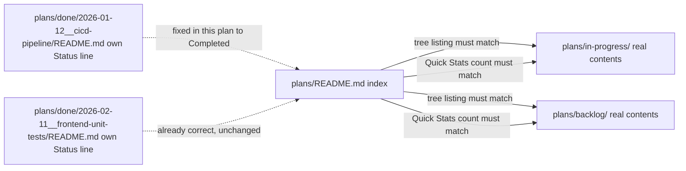

# Fix Plans README Stale Index - Technical Design

## Architecture Overview

This is a pure documentation/index-correction change — no code, no runtime
architecture. The "architecture" here is the set of files that each assert
a fact about where a plan currently lives, and which of them is the single
canonical source after this fix.



**Text equivalent:**

| File                                                   | Role before this plan                                                                                   | Role after this plan                                                                                                                    |
| ------------------------------------------------------ | ------------------------------------------------------------------------------------------------------- | --------------------------------------------------------------------------------------------------------------------------------------- |
| `plans/README.md`                                      | Tree + Quick Stats both claimed 1 active in-progress plan and 1 backlog plan that no longer exist there | Tree + Quick Stats show the real, current contents (0 plan folders in each; a placeholder `README.md` in each)                          |
| `plans/in-progress/`                                   | Did not exist on disk                                                                                   | Exists, tracked via a new placeholder `README.md`                                                                                       |
| `plans/backlog/`                                       | Contained only its own `README.md`, which itself still listed a long-archived plan                      | Contained only its own `README.md`, corrected to list nothing (the CI/CD Pipeline item removed, the duplicate-tracking section deleted) |
| `plans/done/2026-01-12__cicd-pipeline/README.md`       | Own `Status` line said `📋 Backlog` / `Ready to Start`, contradicting its real archived location        | Own `Status` line says `✅ Completed`, consistent with being under `plans/done/`                                                        |
| `plans/done/2026-02-11__frontend-unit-tests/README.md` | Already correctly said `✅ COMPLETED`                                                                   | Unchanged — not touched by this plan                                                                                                    |

_Figure: before this plan, `plans/README.md`'s index and two archived plans'
own status lines disagreed with reality; after this plan, every file
reflects the plan's real current location with no duplicate tracking left
to drift._

## Implementation Approach

Four files, one counted PR (Phase 1), no code, plus one standard
uncounted archival PR (Phase 2) that revisits `plans/README.md` a second
time once this plan's own folder moves to `plans/done/`. Each file gets a
targeted text replacement. Exact current line numbers are cited below as
observed on 2026-11-12 — **re-confirm each with `grep -n` immediately
before editing**, per the Pre-Write Verification rule, since line numbers
shift if anything else edits these files first.

## File 1 (NEW): `plans/in-progress/README.md`

Modeled directly on `plans/backlog/README.md`'s existing structure (purpose
statement → instructions → status legend), adapted for the in-progress
context. Full content:

```markdown
# In Progress Plans

Plans actively being worked on.

## Currently In Progress

_No plans are currently in progress._

## Instructions

**Quick Idea Capture**: For 1-3 liner ideas not ready for formal planning, use `../ideas.md`.

When a plan moves from `backlog/` to `in-progress/`:

1. `git mv plans/backlog/YYYY-MM-DD__project-identifier/ plans/in-progress/`
2. Remove the plan's entry from `plans/backlog/README.md`'s "Planned Projects" list
3. Update `plans/README.md`'s "In Progress" tree listing and "Backlog" tree listing
4. Update `plans/README.md`'s Quick Stats counts for both sections
5. Add the plan to this file's "Currently In Progress" list

When a plan moves from `in-progress/` to `done/`, see `plans/README.md`'s
"Step 4: Move to Done" instructions — remove the plan's entry from this
file's "Currently In Progress" list as part of that step.

## Plan Status Legend

| Status         | Description                            |
| -------------- | -------------------------------------- |
| 📋 Backlog     | Ready to start, pending prioritization |
| 🚧 In Progress | Currently being worked on              |
| ✅ Done        | Completed and shipped                  |
```

## File 2: `plans/README.md`

### Change 2.1 — "In Progress" tree listing

This change has **two stages** because this plan's own folder is itself
briefly under `plans/in-progress/` while Phase 1 executes (see
`requirements.md` Decision #8).

**Current (lines 142-151):**

````markdown
### In Progress

```text
in-progress/
└── 2026-02-11__frontend-unit-tests/
    ├── README.md
    ├── requirements.md
    ├── technical-design.md
    └── checklist.md
```
````

**Phase 1 — interim state (this plan's own PR):**

````markdown
### In Progress

```text
in-progress/
├── README.md
└── 2026-11-12__fix-plans-readme-stale-index/
    ├── README.md
    ├── requirements.md
    ├── technical-design.md
    └── checklist.md
```
````

**Phase 2 — final state (this plan's own archival):**

````markdown
### In Progress

```text
in-progress/
└── README.md
```
````

The `> Note:` lines immediately below (historical records of past moves,
still factually true) are left unchanged in both stages — they are not
part of this bug.

### Change 2.2 — "Backlog" tree listing

**Current (lines 157-166):**

````markdown
### Backlog

```text
backlog/
└── 2026-01-12__cicd-pipeline/
    ├── README.md
    ├── requirements.md
    ├── technical-design.md
    └── checklist.md
```
````

**After:**

````markdown
### Backlog

```text
backlog/
└── README.md
```
````

### Change 2.3 — "Step 3" / "Step 4" instructions

**Current (lines 197-209):**

````markdown
### Step 3: Move to In Progress (when starting)

```bash
git mv plans/backlog/2024-12-15__new-feature/ \
       plans/in-progress/
```

### Step 4: Move to Done (when completed)

```bash
git mv plans/in-progress/2024-12-15__new-feature/ \
       plans/done/
```
````

**After:**

````markdown
### Step 3: Move to In Progress (when starting)

```bash
git mv plans/backlog/2024-12-15__new-feature/ \
       plans/in-progress/
```

After the `git mv`, also:

1. Remove the plan's entry from `plans/backlog/README.md`'s "Planned
   Projects" list.
2. Update this file's "In Progress" and "Backlog" tree listings to match
   the real new contents of each directory.
3. Update this file's Quick Stats counts for both sections.

### Step 4: Move to Done (when completed)

```bash
git mv plans/in-progress/2024-12-15__new-feature/ \
       plans/done/
```

After the `git mv`, also:

1. Update the moved plan's own `README.md` — its `**Status**` line (and
   any other internal status line, e.g. a footer) must say it is
   completed, not in-progress or backlog.
2. Update this file's "In Progress" and "Done (Archived)" tree listings to
   match the real new contents of each directory.
3. Update this file's Quick Stats counts (`In Progress` down by one,
   `Completed Projects` up by one).

**This step is the one most often forgotten** — the two bugs this plan
fixed were both caused by a `git mv` landing without this follow-up.
````

### Change 2.4 — "Quick Stats" section

Also two stages, same reason as Change 2.1.

**Current (lines 301-307):**

```markdown
**In Progress**: 1

- Frontend Unit Tests (Feb 11, 2026)

**Backlog**: 1

- CI/CD Pipeline (Jan 12, 2026)
```

**Phase 1 — interim state:**

```markdown
**In Progress**: 1

- Fix Plans README Stale Index (Nov 12, 2026)

**Backlog**: 0
```

**Phase 2 — final state** (applied as part of this plan's own archival
step, alongside adding its own entry to the "Done (Archived)" tree and
incrementing `Completed Projects`):

```markdown
**In Progress**: 0

**Backlog**: 0
```

`**Completed Projects**: 24` is **not** touched in Phase 1. In Phase 2 it
becomes `25`, with a new bullet for this plan — see Decision #8 in
`requirements.md` for why that one-entry increment is routine archival
practice, not a reopening of the deferred Done-tree backfill. Every other
line in the "Done (Archived)" tree (lines 86-140) is untouched in both
phases.

### Change 2.5 — "Done (Archived)" tree (Phase 2 only)

Standard archival addition, performed when this plan's own folder moves
to `plans/done/`. The last entry in the tree (lines 135-139, the
`2026-11-01__programming-shell/` leaf) gains one new sibling immediately
after it, following the same 4-file leaf pattern every other entry uses:

```markdown
└── 2026-11-01**programming-shell/
├── README.md
├── requirements.md
├── technical-design.md
└── checklist.md
└── 2026-11-12**fix-plans-readme-stale-index/
├── README.md
├── requirements.md
├── technical-design.md
└── checklist.md
```

(The existing `2026-11-01__programming-shell/` leaf's `└──` prefix changes
to `├──` since it is no longer the last entry — standard tree-notation
upkeep, not a content change.) No other leaf in the tree is added,
removed, or reordered.

## File 3: `plans/backlog/README.md`

### Change 3.1 — "Planned Projects" section

**Current (lines 5-13):**

```markdown
## Planned Projects

### Infrastructure

- **[CI/CD Pipeline](./2026-01-12__cicd-pipeline/)** (2026-01-12)
  - GitHub Actions workflow setup
  - Automated testing on push/PR
  - Pre-commit hooks with Claude agents
  - Auto-deployment configuration
```

**After:**

```markdown
## Planned Projects

_No projects are currently in the backlog._
```

### Change 3.2 — "Completed/Moved Plans" section

**Current (lines 15-22, including the preceding `---` separator):**

```markdown
---

## Completed/Moved Plans

The following plans have been moved to `done/` or `in-progress/`:

- **UX Improvements** → moved to `done/2026-01-13__ux-improvements/`
- **Frontend Unit Tests** → moved to `in-progress/2026-02-11__frontend-unit-tests/`
```

**After:** section removed entirely (both the `---` separator and the
heading and its content are deleted). The next section, `## Instructions`,
becomes the one that immediately follows `## Planned Projects`.

"## Instructions" and "## Plan Status Legend" (lines 24-40) are unchanged.

## File 4: `plans/done/2026-01-12__cicd-pipeline/README.md`

### Change 4.1 — Header status block

**Current (lines 1-6):**

```markdown
# CI/CD Pipeline

**Status**: 📋 Backlog
**Created**: January 12, 2026
**Priority**: P1 (High)
**Type**: Infrastructure
```

**After:**

```markdown
# CI/CD Pipeline

**Status**: ✅ Completed
**Created**: January 12, 2026
**Completed**: February 23, 2026
**Priority**: P1 (High)
**Type**: Infrastructure
```

### Change 4.2 — Footer status block

**Current (lines 229-233):**

```markdown
---

**Plan Version**: 1.0
**Last Updated**: January 12, 2026
**Status**: Ready to Start
```

**After:**

```markdown
---

**Plan Version**: 1.0
**Last Updated**: February 23, 2026
**Status**: Completed
```

No other content in this file (the Overview, Scope, Success Criteria,
Timeline, Dependencies, Risks, or Related Plans sections) is touched.

## Verification Method

### Phase 1 verification (after the 4-file PR merges, plan still in-progress)

```bash
# File 1 exists
test -f plans/in-progress/README.md && echo "OK: placeholder exists"

# File 2: In Progress tree shows real interim contents (README.md + this plan's own folder)
ls plans/in-progress/

# File 2: no stale tree entries remain
grep -n "2026-02-11__frontend-unit-tests" plans/README.md   # expect: zero matches
grep -n "2026-01-12__cicd-pipeline" plans/README.md         # expect: zero matches

# File 2: Backlog already at final state; In Progress at interim state; Completed Projects untouched
grep -n "Backlog\*\*: 0" plans/README.md
grep -n "In Progress\*\*: 1" plans/README.md
grep -n "Completed Projects\*\*: 24" plans/README.md        # expect: still present, unchanged

# File 3: no stale backlog entries remain
grep -n "CI/CD Pipeline" plans/backlog/README.md             # expect: zero matches
grep -n "Completed/Moved Plans" plans/backlog/README.md      # expect: zero matches

# File 4: status lines corrected
grep -n "^\*\*Status\*\*" plans/done/2026-01-12__cicd-pipeline/README.md
# expect two matches: "**Status**: ✅ Completed" (header) and "**Status**: Completed" (footer)

# Out-of-scope guard: pre-existing Done tree entries untouched
git diff --stat plans/README.md   # manually confirm only the intended line ranges changed
```

### Phase 2 verification (after this plan's own archival)

```bash
# This plan's folder actually moved (not copied)
test -d plans/done/2026-11-12__fix-plans-readme-stale-index && echo "archived OK"
test -d plans/in-progress/2026-11-12__fix-plans-readme-stale-index && echo "STILL PRESENT - FIX" || echo "no duplicate - OK"
git log --follow --oneline -- plans/done/2026-11-12__fix-plans-readme-stale-index/README.md

# In Progress tree and Quick Stats reached final state
grep -n "In Progress\*\*: 0" plans/README.md
ls plans/in-progress/   # expect: README.md only

# Done tree gained exactly this plan's one new leaf; Completed Projects incremented by exactly 1
grep -n "2026-11-12__fix-plans-readme-stale-index" plans/README.md
grep -n "Completed Projects\*\*: 25" plans/README.md
```

## Non-Functional Considerations

- **No performance, security, or database impact** — markdown-only change.
- **No breaking cross-references**: a repo-wide grep for
  `plans/in-progress/2026-02-11__frontend-unit-tests` and
  `plans/backlog/2026-01-12__cicd-pipeline` (the two stale paths being
  removed from `plans/README.md`'s tree listings) should be run before
  merging to confirm no other living file (outside `plans/done/**`'s own
  historical self-references, which are expected and out of scope) still
  points at either stale path. This mirrors the verification approach used
  in `plans/done/2026-10-29__fix-stale-plan-path-references/`.
