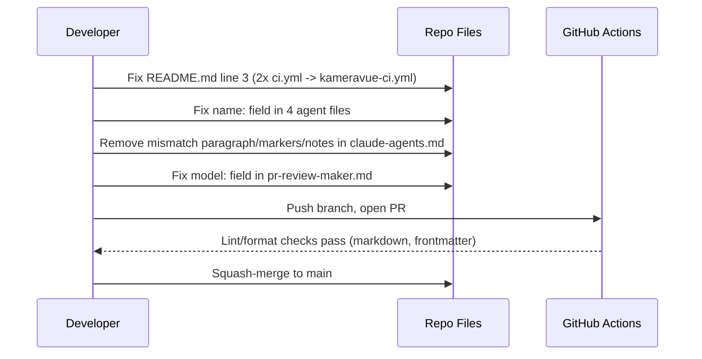

# Technical Design: Fix Three Confirmed Small Bugs

## Architecture Overview

All 3 bugs are static-content edits — no runtime code, no build pipeline, no
database. The "architecture" here is simply which files change and in what
order, so a sequence diagram is more useful than a system diagram: it shows
the single PR's file-touch sequence and the verification gate after it.



## Implementation Approach

Each bug is a direct text substitution with no ambiguity about the
before/after state — all before-text below was re-verified against the live
repo in this same session. No new files, no deletions of files, no renames.

## Files to Modify

- `README.md`
- `.claude/agents/docs-maker.md`
- `.claude/agents/docs-checker.md`
- `.claude/agents/specs-maker.md`
- `.claude/agents/test-checker.md`
- `docs/reference/claude-agents.md`
- `.claude/agents/pr-review-maker.md`

## Change 1 — `README.md` line 3 (Bug 1)

**Before:**

```markdown
[](https://github.com/isnendyankp/ikp-labs/actions/workflows/ci.yml)
```

**After:**

```markdown
[](https://github.com/isnendyankp/ikp-labs/actions/workflows/kameravue-ci.yml)
```

Both occurrences of `ci.yml` become `kameravue-ci.yml`. No other part of
the line changes.

## Change 2 — Agent frontmatter `name:` fields (Bug 2, part A)

Each file's line 2 is the sole line that changes. No other frontmatter
field (`description:`, `model:`, `color:`, `permission.skill:`) is touched.

**`.claude/agents/docs-maker.md` line 2**

- Before: `name: documentation-writer`
- After: `name: docs-maker`

**`.claude/agents/docs-checker.md` line 2**

- Before: `name: docs-validator`
- After: `name: docs-checker`

**`.claude/agents/specs-maker.md` line 2**

- Before: `name: gherkin-spec-writer`
- After: `name: specs-maker`

**`.claude/agents/test-checker.md` line 2**

- Before: `name: test-validator`
- After: `name: test-checker`

## Change 3 — `docs/reference/claude-agents.md` cleanup (Bug 2, part B)

Four edits in this one file, applied as string replacements (not raw line
numbers, since earlier edits in the same file shift later line numbers —
each edit below is anchored on unique surrounding text so ordering doesn't
matter).

### Change 3.1 — Remove the "Known frontmatter/filename mismatch" paragraph

**Before** (currently lines 48-65, i.e. the blank line before the
paragraph through the blank line after it, plus the next heading):

```markdown
guessing.

**Known frontmatter/filename mismatch (4 agents).** A 2026-05-19 rename
changed 5 agent filenames (`plan-writer` → `plan-maker`,
`documentation-writer` → `docs-maker`, `docs-validator` → `docs-checker`,
`gherkin-spec-writer` → `specs-maker`, `test-validator` → `test-checker`) but
only updated the frontmatter `name:` field for `plan-maker`. The other 4 —
`docs-maker.md`, `docs-checker.md`, `specs-maker.md`, and `test-checker.md`
— still carry their pre-rename name inside the frontmatter `name:` field,
even though the filename (and every invocation in this catalog) uses the
current name. Each is flagged with ⚠ in its family table below, with an
inline note explaining the specific mismatch. This is a known, tracked
inconsistency in `.claude/agents/`, not a documentation error — fixing the
frontmatter itself is out of scope for the plan that produced this catalog
rewrite (tracked as a follow-up for `agent-maker`'s domain; see
`plans/done/2026-10-08__fix-claude-agents-catalog-doc/requirements.md`
Non-Scope #1).

## Agent Families
```

**After:**

```markdown
guessing.

## Agent Families
```

### Change 3.2 — Remove `⚠` markers from the Documentation family table

**Before:**

```markdown
| [`docs-maker.md`](../../.claude/agents/docs-maker.md) ⚠ | Maker | Creates and updates documentation following the Diátaxis framework (tutorials, how-to, reference, explanation) | sonnet | purple | docs-applying-content-quality, docs-applying-diataxis-framework, wow-criticality-assessment |
| [`docs-checker.md`](../../.claude/agents/docs-checker.md) ⚠ | Checker | Audits API doc completeness, JSDoc coverage, and Diátaxis categorization; writes `docs-audit-*.md` reports | sonnet | blue | docs-applying-content-quality, docs-applying-diataxis-framework, docs-validating-factual-accuracy, wow-criticality-assessment |
```

**After:**

```markdown
| [`docs-maker.md`](../../.claude/agents/docs-maker.md) | Maker | Creates and updates documentation following the Diátaxis framework (tutorials, how-to, reference, explanation) | sonnet | purple | docs-applying-content-quality, docs-applying-diataxis-framework, wow-criticality-assessment |
| [`docs-checker.md`](../../.claude/agents/docs-checker.md) | Checker | Audits API doc completeness, JSDoc coverage, and Diátaxis categorization; writes `docs-audit-*.md` reports | sonnet | blue | docs-applying-content-quality, docs-applying-diataxis-framework, docs-validating-factual-accuracy, wow-criticality-assessment |
```

Only the `⚠` suffix after the filename link is removed on each row; no
other cell changes. GFM tables render correctly regardless of pipe-column
whitespace alignment, so the now-slightly-uneven column padding is cosmetic
and not a defect.

### Change 3.3 — Remove the 2 inline notes after the Documentation family table

**Before** (currently lines 80-96, i.e. the blank line after the table
through the blank line before the next heading):

```markdown
⚠ `docs-maker.md`: Known issue — this agent's frontmatter `name:` field
still reads `documentation-writer` rather than `docs-maker`, a leftover from
the 2026-05-19 rename. Invocation by `@docs-maker` is the repo convention
going forward; this mismatch is tracked for a follow-up `agent-maker` fix,
out of scope for this plan — see
`plans/done/2026-10-08__fix-claude-agents-catalog-doc/requirements.md`
Non-Scope #1.

⚠ `docs-checker.md`: Known issue — this agent's frontmatter `name:` field
still reads `docs-validator` rather than `docs-checker`, a leftover from the
2026-05-19 rename. Invocation by `@docs-checker` is the repo convention going
forward; this mismatch is tracked for a follow-up `agent-maker` fix, out of
scope for this plan — see
`plans/done/2026-10-08__fix-claude-agents-catalog-doc/requirements.md`
Non-Scope #1.

### 2. Planning (4 agents)
```

**After:**

```markdown
### 2. Planning (4 agents)
```

### Change 3.4 — Remove `⚠` markers from the Testing & Specs family table

**Before:**

```markdown
| [`specs-maker.md`](../../.claude/agents/specs-maker.md) ⚠ | Maker | Creates and updates Gherkin feature files in `specs/`, following the 1-1-1 rule (1 Given, 1 When, 1 Then per scenario) | sonnet | purple | test-coverage-rules, test-playwright-patterns, wow-criticality-assessment |
```

```markdown
| [`test-checker.md`](../../.claude/agents/test-checker.md) ⚠ | Checker | Validates E2E test coverage, specs ↔ test synchronization, and detects flaky tests/brittle selectors; writes `test-audit-*.md` reports | sonnet | blue | test-coverage-rules, test-playwright-patterns, wow-criticality-assessment |
```

**After:**

```markdown
| [`specs-maker.md`](../../.claude/agents/specs-maker.md) | Maker | Creates and updates Gherkin feature files in `specs/`, following the 1-1-1 rule (1 Given, 1 When, 1 Then per scenario) | sonnet | purple | test-coverage-rules, test-playwright-patterns, wow-criticality-assessment |
```

```markdown
| [`test-checker.md`](../../.claude/agents/test-checker.md) | Checker | Validates E2E test coverage, specs ↔ test synchronization, and detects flaky tests/brittle selectors; writes `test-audit-*.md` reports | sonnet | blue | test-coverage-rules, test-playwright-patterns, wow-criticality-assessment |
```

### Change 3.5 — Remove the 2 inline notes after the Testing & Specs family table

**Before** (currently lines 123-139, i.e. the blank line after the table
through the blank line before the next heading):

```markdown
⚠ `specs-maker.md`: Known issue — this agent's frontmatter `name:` field
still reads `gherkin-spec-writer` rather than `specs-maker`, a leftover from
the 2026-05-19 rename. Invocation by `@specs-maker` is the repo convention
going forward; this mismatch is tracked for a follow-up `agent-maker` fix,
out of scope for this plan — see
`plans/done/2026-10-08__fix-claude-agents-catalog-doc/requirements.md`
Non-Scope #1.

⚠ `test-checker.md`: Known issue — this agent's frontmatter `name:` field
still reads `test-validator` rather than `test-checker`, a leftover from the
2026-05-19 rename. Invocation by `@test-checker` is the repo convention going
forward; this mismatch is tracked for a follow-up `agent-maker` fix, out of
scope for this plan — see
`plans/done/2026-10-08__fix-claude-agents-catalog-doc/requirements.md`
Non-Scope #1.

### 4. SWE Language Devs (7 agents)
```

**After:**

```markdown
### 4. SWE Language Devs (7 agents)
```

## Change 4 — `.claude/agents/pr-review-maker.md` line 5 (Bug 3)

**Before:**

```yaml
model:
```

**After:**

```yaml
model: sonnet
```

No other frontmatter field in this file changes. `color: blue` (line 6)
and `tools: Read, Bash, Grep, Glob, WebFetch, WebSearch` (line 4) are
unchanged.

## Integration Points

None — these are isolated documentation/metadata edits with no code paths,
no API contracts, no database schema, and no other file depending on the
specific text being changed (confirmed via the fan-out `grep` checks in
`requirements.md`).

## Verification Method

After all edits, run on `main`:

```bash
grep -c "workflows/ci\.yml" README.md          # expect 0
grep -c "workflows/kameravue-ci\.yml" README.md # expect 2
grep -n "^name:" .claude/agents/docs-maker.md .claude/agents/docs-checker.md \
  .claude/agents/specs-maker.md .claude/agents/test-checker.md
# expect: docs-maker, docs-checker, specs-maker, test-checker respectively
grep -n "mismatch\|⚠" docs/reference/claude-agents.md  # expect 0 matches
grep -n "^model:" .claude/agents/pr-review-maker.md     # expect "model: sonnet"
```
