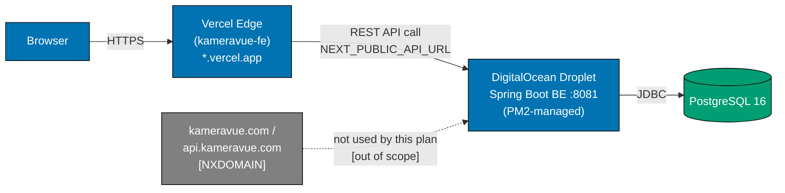
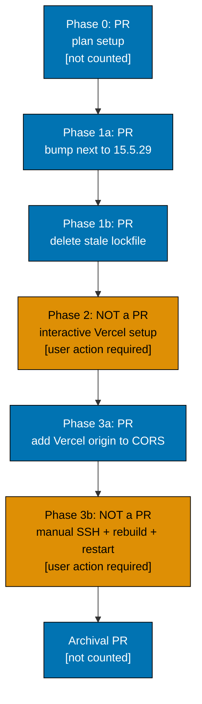

# Technical Design: Deploy Frontend to Vercel

## Confirmed Current State (verified 2026-11-21, not assumed)

| Fact                                                                                | Verification method                                                                         | Result                                                                                                                                                                                                  |
| ----------------------------------------------------------------------------------- | ------------------------------------------------------------------------------------------- | ------------------------------------------------------------------------------------------------------------------------------------------------------------------------------------------------------- |
| `next`/`eslint-config-next` pinned version                                          | `grep -n '"next"' apps/kameravue-fe/package.json`                                           | `"next": "15.5.0"`, `"eslint-config-next": "15.5.0"` (exact, no caret)                                                                                                                                  |
| Root lockfile's resolved `next` version                                             | `node -e "require('./package-lock.json')..."`                                               | `15.5.0` — same as package.json, not yet patched                                                                                                                                                        |
| Nested lockfile's resolved `next`/`@playwright/test`                                | same technique on `apps/kameravue-fe/package-lock.json`                                     | `next@15.5.0`, `@playwright/test@1.55.0` (stale vs. root's current `1.65.1`)                                                                                                                            |
| Nested lockfile's git origin                                                        | `git log --oneline --follow -- apps/kameravue-fe/package-lock.json`                         | Introduced by `3d4c322 refactor: migrate frontend to Nx apps/kameravue-fe`; never touched since                                                                                                         |
| Nested lockfile usage in CI                                                         | `grep -n "npm ci\|working-directory" .github/workflows/kameravue-ci.yml`                    | Every `npm ci` runs at repo root; `working-directory: apps/kameravue-fe` is only used for `npm run lint:check`, `format:check`, and `jest`, never for install                                           |
| Any other reference to the nested lockfile path                                     | `grep -rn "kameravue-fe/package-lock"` repo-wide                                            | Only `.nx/workspace-data/file-map.json`, which `.gitignore` lines 14-15 exclude                                                                                                                         |
| Existing backend deploy automation                                                  | `grep -rln "ssh\|droplet\|pm2\|deploy" .github/workflows/*.yml`; `find . -iname "*deploy*"` | Zero matches — no CD pipeline, no deploy script                                                                                                                                                         |
| `kameravue.com` / `api.kameravue.com` DNS status                                    | `nslookup kameravue.com`; `curl https://api.kameravue.com` (both from this environment)     | `NXDOMAIN` / "Could not resolve host" — confirmed real, not a sandbox network restriction (`vercel.com` and `1.1.1.1` resolved fine from the same shell)                                                |
| Next.js CVE affecting `15.5.0`                                                      | Web research, 2026-11-21                                                                    | CVE-2026-96889 — two unauthenticated RCEs (CVSS 9.5) in the caching layer and SVG image pipeline, affecting `10.0.0`–`15.5.27`, fixed in `15.5.28`; `15.5.29` is the latest safe patch on the 15.x line |
| `.env.local` existence (content never read — blocked by `block-env-file-access.sh`) | `ls -la apps/kameravue-fe/.env*`                                                            | `apps/kameravue-fe/.env.local` exists (201 bytes)                                                                                                                                                       |
| Backend production deploy mechanics                                                 | `README.md` lines 120-126, 175-210                                                          | DigitalOcean Droplet, Ubuntu 24.04, Nginx + Let's Encrypt, PM2 process manager, PostgreSQL 16; Maven build (`./mvnw clean install`) produces the JAR that PM2 runs                                      |

## Architecture Overview



_Figure 1: The frontend moves to Vercel's own domain; the backend and
database stay on the DigitalOcean Droplet unchanged. The old
`kameravue.com`/`api.kameravue.com` domain (gray, labeled NXDOMAIN) is
fully bypassed — neither the browser nor the frontend talks to it after
this plan._

**Text equivalent:**

| Component                             | Role after this plan                                                       | Talks to                                        |
| ------------------------------------- | -------------------------------------------------------------------------- | ----------------------------------------------- |
| Browser                               | End-user client                                                            | Vercel Edge (HTTPS)                             |
| Vercel Edge (`*.vercel.app`)          | Hosts `apps/kameravue-fe`, built with Root Directory = `apps/kameravue-fe` | DigitalOcean Droplet, via `NEXT_PUBLIC_API_URL` |
| DigitalOcean Droplet                  | Unchanged — Spring Boot backend, PM2-managed, port 8081                    | PostgreSQL via JDBC                             |
| PostgreSQL 16                         | Unchanged                                                                  | —                                               |
| `kameravue.com` / `api.kameravue.com` | Out of scope, confirmed NXDOMAIN, not referenced by the new deploy         | —                                               |

## Phase Flow (why this plan is not a pure PR sequence)



_Figure 2: Blue phases are ordinary git/PR work executable via tools. Orange
phases require the user's own interactive action (a Vercel dashboard
login/click-through, or an SSH session to the Droplet) and cannot be
executed by `git`/`gh` commands — these are the plan's two pause points._

**Text equivalent:**

| Phase    | Executable via tools? | Blocking action                                                                     |
| -------- | --------------------- | ----------------------------------------------------------------------------------- |
| 0        | Yes (PR)              | None                                                                                |
| 1a       | Yes (PR)              | None                                                                                |
| 1b       | Yes (PR)              | None                                                                                |
| 2        | **No**                | User logs into Vercel, imports repo, configures project, deploys                    |
| 3a       | Yes (PR)              | Depends on Phase 2's confirmed Vercel origin                                        |
| 3b       | **No**                | User (or operator with SSH access) rebuilds and restarts the backend on the Droplet |
| Archival | Yes (PR)              | Depends on all above being confirmed complete                                       |

## Implementation Approach

### Phase 1a — Patch the Next.js CVE

Files touched:

- `apps/kameravue-fe/package.json` — bump `"next": "15.5.0"` →
  `"next": "15.5.29"` and `"eslint-config-next": "15.5.0"` →
  `"eslint-config-next": "15.5.29"` (kept in lockstep, as these two packages
  are version-matched by convention).
- `package-lock.json` (repo root) — regenerated by running `npm install`
  from the repo root after the `package.json` edit, so the lockfile
  reflects the patched dependency tree (including the transitively bundled
  `sharp` version referenced by the CVE advisory).

No code changes are needed beyond the version bump — CVE-2026-96889 is a
runtime vulnerability in Next.js's own caching/image-processing internals,
not a usage pattern in this app's code.

### Phase 1b — Delete the stale nested lockfile

Files touched:

- `apps/kameravue-fe/package-lock.json` — deleted via `git rm`.

No other file requires a change: CI's `npm ci` already runs at the repo
root in every job (confirmed above), so removing the nested file changes
nothing about how CI or local development installs dependencies.

### Phase 2 — Interactive Vercel project setup (not a PR)

Performed live, in conversation, by the user (account-gated actions) with
guidance from the assistant. See `checklist.md` for the exact numbered
walkthrough with dashboard field names and values. Key configuration:

| Vercel dashboard field | Value                                                                                                                                                                            |
| ---------------------- | -------------------------------------------------------------------------------------------------------------------------------------------------------------------------------- |
| Framework Preset       | Next.js (auto-detected)                                                                                                                                                          |
| Root Directory         | `apps/kameravue-fe`                                                                                                                                                              |
| Build Command          | default (`next build`, from `apps/kameravue-fe/package.json`'s `"build"` script)                                                                                                 |
| Install Command        | default (`npm install`/`npm ci`, now resolving against the root lockfile since the nested one is gone)                                                                           |
| Environment Variable   | `NEXT_PUBLIC_API_URL` = `http://<DROPLET_IP_FROM_USER>:8081` (resolved grill-me decision 4 — the real IP is supplied by the user at execution time, not guessable from the repo) |

No `vercel.json` is committed (resolved grill-me decision 3) — Root
Directory is a project-level dashboard setting, not something a committed
file is required for.

### Phase 3a — Add the Vercel origin to CORS

File touched: `apps/kameravue-be/ikp-labs-api/src/main/java/com/ikplabs/api/config/CorsConfig.java`.

Current state (confirmed by direct read, lines 60-71):

```java
configuration.setAllowedOrigins(Arrays.asList(
    // Development origins
    "http://localhost:3002",     // Frontend development server (IKP-Labs custom port)
    "http://127.0.0.1:3001",     // Alternative localhost format
    "http://localhost:3000",     // Standard React port (for other projects)
    "http://localhost:3003",     // Auto-assigned port by Next.js (current)
    "http://localhost:3004",     // Auto-assigned port by Next.js
    "http://localhost:3005",     // Auto-assigned port by Next.js
    // Production origins
    "https://kameravue.com",     // Production frontend
    "https://www.kameravue.com"  // Production frontend (www subdomain)
));
```

Target state — add one entry after the existing production origins, with
the real URL confirmed from Phase 2 (not guessed now):

```java
configuration.setAllowedOrigins(Arrays.asList(
    // Development origins
    "http://localhost:3002",     // Frontend development server (IKP-Labs custom port)
    "http://127.0.0.1:3001",     // Alternative localhost format
    "http://localhost:3000",     // Standard React port (for other projects)
    "http://localhost:3003",     // Auto-assigned port by Next.js (current)
    "http://localhost:3004",     // Auto-assigned port by Next.js
    "http://localhost:3005",     // Auto-assigned port by Next.js
    // Production origins
    "https://kameravue.com",     // Production frontend (currently NXDOMAIN — kept, not removed; out of scope to delete per this plan's scope)
    "https://www.kameravue.com", // Production frontend (www subdomain)
    "<VERCEL_URL_FROM_PHASE_2>"  // Vercel-hosted frontend (decoupled from Hostinger)
));
```

`<VERCEL_URL_FROM_PHASE_2>` is an explicit placeholder — the real
`https://<project-name>.vercel.app` value is only knowable once Phase 2
actually runs, confirmed in the dashboard, and substituted in at execution
time. The existing `kameravue.com` entries are left in place: removing them
is not part of this plan's scope, and they do no harm sitting unused while
DNS is down.

### Phase 3b — Manual backend redeploy (not a PR)

Spring Boot does not hot-reload a changed `.java` file in a running
production JAR — the change only takes effect after a rebuild and process
restart. Since no CD pipeline exists (confirmed above), this is a manual
SSH session. Inferred procedure, built from `README.md`'s documented PM2
commands and standard Maven build (`./mvnw clean install`, confirmed in
`README.md` line 466) — the exact SSH host and PM2 process name are not
in the repo and are confirmed with the user at execution time:

```bash
ssh <DROPLET_SSH_HOST>
cd <PATH_TO_REPO_ON_DROPLET>
git pull origin main
cd apps/kameravue-be/ikp-labs-api
./mvnw clean install
pm2 restart <PM2_PROCESS_NAME>
pm2 logs <PM2_PROCESS_NAME>   # confirm clean restart, no CORS-related startup errors
```

## Technology Choices

- **Vercel over any other static/edge host**: free tier, zero-config
  Next.js support (same vendor as the framework), instant `*.vercel.app`
  subdomain with managed TLS, and no dependency on the Hostinger account.
- **Backend stays on the DigitalOcean Droplet**: explicitly out of scope to
  move — the Droplet is unaffected by the Hostinger domain issue; only its
  DNS-based hostname (`api.kameravue.com`) is currently unreachable, not
  the server itself.
- **Next.js patched within the 15.x line, not upgraded to 16.x**: keeps the
  security fix minimal and independently revertable, per resolved grill-me
  decision 2 — a major-version upgrade is explicitly out of scope.

## Integration Points

- **`NEXT_PUBLIC_API_URL`** is the sole integration point between the
  Vercel-hosted frontend and the Droplet-hosted backend. It is a build-time
  public env var (Next.js convention: `NEXT_PUBLIC_*` vars are inlined into
  the client bundle), configured once in the Vercel dashboard during Phase
  2, consumed by the frontend's existing `fetch(...)` calls (per the
  project's documented API Call Pattern).
- **CORS (`CorsConfig.java`)** is the backend-side half of the same
  integration — without the Phase 3a addition, the browser blocks every
  cross-origin request from the new Vercel URL even though the network
  request itself would succeed.
